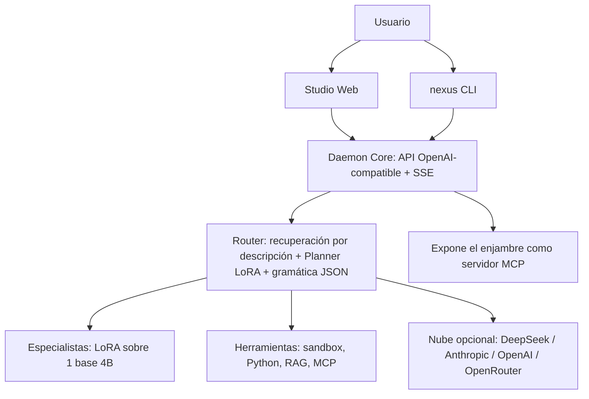

# Spike — Plan Maestro v3 (ejecutable por agente)

> Nombre en clave: **Spike** (provisional, ver S6). Ejecutor: codex. Dueño: Joan.
> Fuente de verdad. Cambiar una decisión exige un ADR en `docs/adr/`. Lo marcado **(verificar)** no está comprobado: se confirma en la Fase 0.

---

## 0. Reglas del agente (obligatorias)

1. **Nada sin medir.** Toda cifra pública sale de `make eval` / `make bench`, guardada en `reports/` con fecha y commit.
2. **Gates.** Cada fase termina con criterios verificables. Si uno falla: para, documenta en `docs/spikes/`, propone Plan B. Nunca maquilles resultados.
3. **Coste 0 €.** Solo herramientas, datos y cómputo gratuitos. Cualquier cosa de pago es un bloqueo a reportar.
4. **Hardware objetivo: 16 GB de RAM sin GPU dedicada.** El Mac de desarrollo (36 GB) no es la referencia.
5. **Clean-room** para cualquier producto de terceros (§13). Prohibido copiar código, assets, fuentes, iconos, textos o nombres.
6. **Licencias y procedencia.** `DATA_LICENSES.md` por cada fuente. Prohibido entrenar con salidas de modelos cuyos términos lo vetan (Gemini, Claude, ChatGPT). Evitar datos NC (no comercial) y revisar share-alike.
7. **Contenido vetado en datasets:** armas, CBRN, síntesis de sustancias peligrosas, malware/exploits armados, material de menores. "Sin rechazos" aplica al dominio legítimo, nunca a esto.
8. **Antes de instalar una skill/MCP de terceros:** fijar commit, leer su `SKILL.md` y scripts, y rechazar lo que ejecute o descargue cosas no explicadas (riesgo de cadena de suministro).
9. Commits convencionales, PRs pequeños, tests con cada módulo, CI en verde para fusionar.
10. Dudas: un único mensaje agrupado a Joan. No inventes.

---

## 1. Visión y métricas (v1.0)

**Frase:** *Un equipo de especialistas de IA con orquestador que corre en un portátil de 16 GB, sin nube, sin telemetría y sin coste.*

**Argumento para empresas:** 100 % local y offline, datos que nunca salen de la máquina, instalable on-prem, política de seguridad configurable (`policy.yaml`), licencias limpias y auditables, evals reproducibles.

| Métrica | Objetivo |
|---|---|
| RAM de modelos (base + adaptadores activos) | ≤ 6 GB |
| RAM total en uso (daemon + UI + modelos) | ≤ 10 GB |
| Instalación | 1 comando, < 10 min; primer token < 5 s |
| Cada especialista publicado | Mejora significativa (IC 95 % bootstrap) sobre la base en su eval, medida **sobre el modelo cuantizado** que se distribuye |
| Regresión general | ≤ 2 pts en MMLU (o equivalente) |
| Rechazos | < 3 % en set held-out de prompts sensibles legítimos |
| Orquestador | ≥ 95 % de planes en JSON válido; ≥ 90 % de acierto de routing en 300+ prompts etiquetados, **con especialistas nuevos sin reentrenarlo** |

**No objetivos:** igualar a modelos frontera en general; entrenar desde cero; multimodal en v1; app nativa en v1.
**Honestidad:** "nivel Opus" solo se afirma en una eval concreta que lo demuestre, citándola.

---

## 2. Arquitectura y decisiones



| Tema | Decisión | Plan B |
|---|---|---|
| Base | **Qwen3.5-4B** (Apache-2.0; thinking + tool-calling; híbrida con estado recurrente: contexto largo con memoria casi plana) | Gemma 4 E4B, Qwen3-4B |
| Draft para velocidad | **Qwen3.5-0.8B** como modelo borrador de *speculative decoding* (verificar soporte y ganancia en CPU) | Sin speculative |
| Especialistas | **1 base + 1 LoRA por rol**, `llama-server --lora-init-without-apply`, adaptador por petición | GGUF fusionados con swap |
| Entrenamiento | **MLX-LM LoRA en el Mac** (principal) · **Unsloth** en Colab/Kaggle gratuito (secundario; sus notebooks gratuitos cubren Qwen3.5 0.8B/2B/4B) | TRL/PEFT |
| De-refusal | SFT "responde, no rechaces" en prompts sensibles legítimos | Abliteración opcional al final (midiendo KL y regresión) |
| Servidor | Node 22+/TS, Fastify, API **compatible con OpenAI**, SSE | — |
| Conectores | **MCP** (cliente) + APIs opcionales con claves en el keychain del SO | — |
| Búsqueda local | SQLite + FTS5 + sqlite-vec para Knowledge Packs (verificar) | LanceDB |
| UI | React 19 + Vite + Tailwind 4, servida por el daemon | — |
| CLI | TypeScript + Ink; **base sugerida: fork de un harness Apache/MIT** (ver §13) | Desde cero |
| Distribución | `install.sh` + `npx` + Homebrew tap + Docker Compose; pesos en Hugging Face | — |

Notas: no usar DSML (es de DeepSeek); usar el formato de tool-calling nativo de la base y envolverlo en una capa OpenAI-compatible. Entrenar con ejemplos **thinking y no-thinking** en el formato nativo de la base.

---

## 3. Skills, plugins y MCP a usar (investigados en GitHub)

### 3.1 OBLIGATORIAS (flujo de trabajo del agente)

| Skill / plugin | Fuente | Instalación | Uso |
|---|---|---|---|
| **Superpowers** (`using-superpowers`, `brainstorming`, `writing-plans`, `subagent-driven-development`, `test-driven-development`, `systematic-debugging`, `verification-before-completion`, `requesting-code-review`, `using-git-worktrees`, `writing-skills`) | `github.com/obra/superpowers` (MIT) | Antigravity: `agy plugin install https://github.com/obra/superpowers` · Gemini CLI: `gemini extensions install https://github.com/obra/superpowers` | **Siempre**: brainstorming → writing-plans → ejecución por subagentes con TDD → verificación antes de dar nada por terminado |
| **frontend-design** | `github.com/anthropics/skills` | `npx skills add anthropics/skills@frontend-design` | Toda la UI: tipografía, composición, evitar aspecto genérico |
| **webapp-testing** | `anthropics/skills` | `npx skills add anthropics/skills@webapp-testing` | Pruebas e2e con Playwright de Studio |
| **mcp-builder** | `anthropics/skills` | `npx skills add anthropics/skills@mcp-builder` | Cliente/servidor MCP, Knowledge Pack servers, exposición del enjambre como MCP |
| **skill-creator** | `anthropics/skills` | `npx skills add anthropics/skills@skill-creator` | Crear y evaluar las skills propias (§3.3) |
| **Hugging Face skills** (`hf-llm-trainer`, datasets, evaluation, cli) | `github.com/huggingface/skills` | `gemini extensions install https://github.com/huggingface/skills.git --consent` | Guías y scripts de SFT con TRL, conversión a GGUF, estimación de memoria, model cards con `model-index`. **Usar solo la guía/scripts locales: HF Jobs es de pago** |
| **REA** (MCP de ingeniería inversa) | `github.com/morluto/rea` | `npx rea-agents setup` (Gemini CLI soportado; Antigravity por registro MCP manual) | Estudio UX/harness clean-room (§13) |

### 3.2 RECOMENDADAS

- `anthropics/skills`: `web-artifacts-builder` (panel de Artifacts), `theme-factory` (sistema de diseño), `doc-coauthoring` (docs y ADRs). Revisar la licencia de cada una; usarlas como **guía de desarrollo, sin redistribuirlas** dentro del repo.
- **Servidores MCP de referencia** (`modelcontextprotocol/servers`): `filesystem`, `git`, `fetch`, `memory`. Más Playwright MCP y un MCP de documentación de librerías (p. ej. Context7) (verificar).
- Catálogos agregados (p. ej. *Antigravity Awesome Skills*, `agent-skills-lint`) **solo para explorar** y siempre aplicando la regla 8.

### 3.3 Skills propias a crear con `skill-creator` (commit en `.agent/skills/`)

| Skill | Función |
|---|---|
| `nexus-honest-claims` | Antes de escribir README, model cards o posts: exige enlazar cada cifra a un fichero de `reports/`. Bloquea afirmaciones sin evidencia |
| `nexus-eval-gate` | Ejecuta el gate de un especialista y devuelve PASS/FAIL con tabla |
| `nexus-data-license-audit` | Revisa cada fuente: licencia, procedencia del modelo generador, NC/SA, PII |
| `nexus-specialist-factory` | Crea un especialista nuevo a partir de `specialist.yaml` (§5) |
| `nexus-clean-room` | Checklist anti-copia (assets, strings, marca) antes de cada PR de UI |
| `nexus-release-checklist` | Versionado, notas, pesos en HF, checksums, plan de lanzamiento |

### 3.4 Protocolo de uso por fase

| Fase | Skills que **deben** invocarse |
|---|---|
| Diseño de cada módulo | `brainstorming` → `writing-plans` |
| Implementación | `subagent-driven-development` + `test-driven-development` + `using-git-worktrees` |
| Entrenamiento/datos/evals | `hf-llm-trainer`, `huggingface-datasets`, `huggingface-evaluation`, `nexus-data-license-audit`, `nexus-eval-gate` |
| UI | `frontend-design`, `web-artifacts-builder`, `webapp-testing`, `nexus-clean-room` |
| MCP | `mcp-builder` |
| Bugs | `systematic-debugging` |
| Cierre de tarea | `verification-before-completion` + `requesting-code-review` |
| README/posts/model cards | `nexus-honest-claims` |

---

## 4. Catálogo de especialistas

Con 1 base + adaptadores, añadir un rol cuesta ~decenas/pocos cientos de MB y **ningún modelo extra en RAM**. Un especialista **solo se publica si pasa su gate**; no hay especialistas "de relleno".

### Tier 1 — v1.0 (8)

| # | Especialista | Alcance | Evals de puerta | Datos (capas A/B/C, §5) | Herramientas |
|---|---|---|---|---|---|
| 1 | **Finance** | Valoración, contabilidad, informes, riesgo, lectura de tablas | FinQA, ConvFinQA, TAT-QA, FinanceBench (subset) | A: SEC EDGAR (dominio público). B: train de FinQA/ConvFinQA/TAT-QA (verificar licencias). C: Q&A verificado por cálculo | Python/calculadora, lector de tablas |
| 2 | **Medicine** | Clínica, farmacología, triaje, lectura de papers; calibración | MedQA, PubMedQA, MedMCQA + set propio de seguridad clínica | A: subconjunto abierto de PubMed Central con licencias CC, DailyMed/openFDA. B: train de MedQA/MedMCQA/PubMedQA (verificar). C: razonamiento con respuesta verificable | RAG sobre Knowledge Pack clínico |
| 3 | **Marketing** | Brief, copy de respuesta directa, SEO, CRO, campañas | Comparación por pares con rúbrica y juez local | C: síntesis con rúbrica; A: textos propios/dominio público | Analizadores SEO/legibilidad, búsqueda opcional |
| 4 | **Code** | Escribir, depurar, revisar y explicar código | HumanEval+, MBPP+, LiveCodeBench (subset) | B: split de código de Nemotron-Post-Training v2, SmolTalk2. C: problemas con tests ejecutables | Sandbox de ejecución + tests |
| 5 | **Math & Data Science** | Matemáticas, estadística, análisis de datos | GSM8K, MATH-500, set de estadística propio | B: split de matemáticas de Nemotron v2; OpenMathReasoning (verificar licencia). C: problemas con solución simbólica | Python/sympy |
| 6 | **Legal** | Análisis de contratos y normativa, jurisprudencia (UE/ES/EE. UU.) | LegalBench (subset), LexGLUE, CaseHOLD | A: EUR-Lex, BOE, Caselaw Access Project (verificar licencia). C: Q&A con cita | RAG sobre legislación |
| 7 | **Cybersecurity (defensivo)** | Análisis de amenazas, hardening, revisión de código seguro, informes de pentest autorizado, CTF educativo | CyberMetric, SecQA, CTIBench (verificar) | A: MITRE ATT&CK, NVD/CVE, CWE, OWASP, RFCs. **Sin** generación de malware ni exploits armados | RAG, analizadores estáticos |
| 8 | **Writing & Editing** | Redacción, edición, tono, estructura, narrativa | Pares con rúbrica + juez local | A: Project Gutenberg (dominio público). C: síntesis | Verificadores de estilo |

### Tier 2 — v1.1 a v1.3 (≈ +4 por versión)

| Especialista | Evals de puerta | Datos clave |
|---|---|---|
| Science (física, química, biología; **sin síntesis peligrosa**) | GPQA (subset), MMLU-STEM, SciQ | OpenStax (CC BY), Nemotron v2 ciencia |
| Education / Tutor socrático | Pares + MMLU | OpenStax, diálogos socráticos sintéticos |
| SQL & Analytics | Spider/BIRD (verificar licencias) | Text-to-SQL sintético ejecutable |
| Translation es/ca/en/fr/pt | FLORES-200, WMT | Nemotron v2 multilingüe (incluye español), corpus abiertos (verificar) |
| DevOps / SysAdmin / Redes | Set propio + MMLU-CS | RFCs, documentación con licencia permisiva |
| Business Strategy & Management | Pares con rúbrica | Síntesis |
| Product / UX / Design | Pares con rúbrica | Síntesis |
| Research Analyst (citas y síntesis) | Exactitud de atribución | RAG, papers de acceso abierto |
| Accounting & Tax (por país) | Set propio | Normativa pública |
| Nutrition & Fitness | Set propio | USDA FoodData Central (dominio público) |
| Psychology / Wellbeing | Set de seguridad estricto. **Política máxima**: protocolo de crisis y derivación; nunca "sin rechazos" en autolesión | Síntesis supervisada |
| Engineering (eléctrica/mecánica) | Set propio | Libros y estándares abiertos |

### Tier 3 — comunidad (Specialist Packs)

HR, inmobiliario, deportes, agricultura, música, idiomas concretos, juegos, arquitectura, etc. El formato de §5 permite que cualquiera añada uno con su gate.

---

## 5. Specialist Factory (cómo se construye cada modelo)

Un especialista = una carpeta `specialists/<nombre>/` con **`specialist.yaml`**:

```yaml
name: finance
tier: 1
description: "Valoración, contabilidad, informes financieros, riesgo."   # lo usa el router
license: apache-2.0
base: qwen3.5-4b
data:
  layers:
    A: [{source: sec-edgar, license: public-domain, share: 0.20}]
    B: [{source: nemotron-post-training-v2/math, license: cc-by-4.0, share: 0.10}]
    C: [{teacher: local-open-model, verifier: calculator, share: 0.30}]
    replay_general: 0.25
    tooling_format: 0.15
evals: {gate: [finqa, convfinqa, tatqa], regression: [mmlu], refusal: sensitive-finance-v1}
tools: [python_sandbox, table_reader]
knowledge_pack: null
policy: {default_level: standard}
```

`forge build <nombre>` ejecuta de punta a punta: **datos → filtro → entrenar → evaluar → exportar → model card**. Un CI valida cada YAML.

### 5.1 Datos: tres capas, todas auditables

- **A. Dominio público / licencia abierta:** SEC EDGAR, PubMed Central (subconjunto abierto), DailyMed/openFDA, NVD/CWE/ATT&CK, EUR-Lex, BOE, Project Gutenberg, USDA, OpenStax. Verificar la licencia concreta de cada subconjunto.
- **B. Conjuntos de post-entrenamiento permisivos:** SmolTalk2 (Apache-2.0), Nemotron-Post-Training v2 (CC-BY-4.0, respuestas generadas por modelos abiertos, incluye español) y las listas curadas de `mlabonne/llm-datasets` (comprobar licencia de cada uno). **Evitar** Nemotron v1 (arrastra la licencia Llama) y las partes NC de Tulu 3.
- **C. Síntesis con verificador:** un **profesor local** de licencia abierta (candidato: Qwen3.5-35B-A3B cuantizado, ~3B parámetros activos, cabe en 36 GB; verificar velocidad). Respuestas aceptadas solo si pasan verificador (calculadora, tests, ejecución SQL, respuesta de referencia) o rúbrica con juez local.
- **Linaje honesto:** la model card lista qué modelos generaron qué fracción. "Destilado de DeepSeek-V4.1-Flash" solo si hay datos suyos reales y en esa proporción; si no, "datos de razonamiento de modelos abiertos".
- **Calidad:** dedupe (MinHash), filtros de longitud y formato, **descontaminación** frente a todos los sets de evaluación, limpieza de PII, `DATA_LICENSES.md` actualizado.
- **Herramientas candidatas:** `distilabel` y `datatrove` para generación/limpieza (verificar mantenimiento y licencia), `lm-evaluation-harness` y `lighteval` para evals.

### 5.2 Receta de entrenamiento (valores de partida; ajustar con evals)

1. **SFT con LoRA:** r=32, α=32–64, todas las capas lineales compatibles (en la arquitectura híbrida, comprobar qué módulos existen), lr 1e-4–2e-4 con coseno y warmup ~3 %, 2–3 épocas, batch efectivo 32–64, secuencia 4096 (8192 para legal/finanzas), *packing*. **5k–20k ejemplos de calidad** por rol.
2. **Anti-olvido:** 25 % de replay general, rango bajo, parada temprana si regresa MMLU > 2 pts.
3. **Opcional — preferencias (DPO/SimPO):** 3k–10k pares (mejor vs peor respuesta según verificador).
4. **Opcional (Tier 2) — RL verificable (GRPO)** para matemáticas, código, SQL y finanzas numéricas.
5. **De-refusal:** set de prompts sensibles legítimos por dominio respondidos por completo; medir rechazo en held-out; abliteración solo si aporta y no rompe evals.
6. **Exportar:** adaptador PEFT → GGUF LoRA (conversor de llama.cpp) y base Q4_K_M. **Evaluar siempre sobre el modelo cuantizado y con el adaptador cargado como en producción.**
7. **Cómputo:** Mac (MLX) para la mayoría; Kaggle/Colab gratuitos para lo que lo necesite. Registrar tok/s, RAM pico y horas por rol en `reports/`.

### 5.3 Gate por especialista

Mejora significativa en su eval · regresión ≤ 2 pts · rechazos < 3 % · formato y tool-calling intactos · RAM y latencia dentro de presupuesto · model card con limitaciones. Si falla: no se publica.

---

## 6. Orquestador (poco conocimiento, mucha coordinación)

- **Routing en dos etapas, sin reentrenar al añadir roles:** (1) *recuperación* sobre las `description` de los especialistas con un modelo de embeddings pequeño (p. ej. ~100–300 M; verificar licencia y calidad en es/ca/en) → top-3; (2) el **Planner LoRA** decide, produce el DAG y asigna herramientas.
- **JSON garantizado:** decodificación con gramática GBNF/JSON-schema + router determinista de respaldo si la confianza es baja.
- **Verificador y reintento:** comprueba salidas con tests, calculadora, ejecución o un segundo especialista; *self-consistency* / mejor-de-n solo donde hay verificador.
- **Modos:** Auto (por defecto), Manual, Council. En 16 GB se ejecuta en cola salvo que haya RAM/slots (medir).
- **Escalado opcional a la nube** si el detector de tarea difícil lo sugiere y el usuario lo ha activado.
- **Datos de entrenamiento:** tareas multi-dominio sintéticas con plan de referencia + 300+ prompts de routing etiquetados a mano.

---

## 7. Runtime (`packages/core`)

API OpenAI-compatible + SSE · cola/slots · capa `policy.yaml` (`off | standard | strict`) · sandbox de bash con permisos `allow | ask | deny` y confinamiento · Python/calculadora · cliente MCP · memoria en SQLite · trazas JSON por ejecución · modelo de amenazas (inyección vía herramientas, exfiltración) · **modo air-gapped** (sin ninguna llamada de red) · **exposición del enjambre como servidor MCP** para que otras herramientas (IDEs, otros agentes) usen los especialistas como tools.

---

## 8. Studio (UI) — marca propia

Construida con `frontend-design`, desde el UX-spec (§13).
- Chat con razonamiento plegable, indicador del rol activo, adjuntos, historial, proyectos, memoria, plantillas.
- **Artifacts** en iframe aislado con CSP: Markdown, HTML, SVG, Mermaid, código, CSV, gráficos; vista previa, código, descarga.
- **Builder:** plan → archivos → vista previa en vivo → iteración, para "crear cosas" de punta a punta.
- **Catálogo de especialistas:** instalar, activar y actualizar roles desde la UI, con su eval visible.
- Conectores MCP y APIs, selector Auto/Manual/Council, **Swarm Visualizer** en vivo, panel de RAM y velocidad.
- **Bench page** pública (GitHub Pages) con resultados y comparativas reproducibles.
- es/ca/en, claro/oscuro, WCAG AA, atajos, rendimiento local < 1,5 s.
- Identidad propia: logo SVG, paleta y tipografías OFL.

---

## 9. CLI (`nexus`)

TUI y modo no interactivo (`-p`, `--json`) · modo plan · permisos por herramienta · comandos `/` (`/plan`, `/council`, `/specialist`, `/mcp`, `/doctor`, `/install`) · skills como carpetas `SKILL.md` · subagentes = especialistas · hooks · reanudar sesión · `nexus doctor`.

---

## 10. Instalador

`install.sh` (macOS/Linux) + PowerShell + Docker Compose. Detecta SO, arquitectura y RAM → perfil (8 / 16 / 32 GB+). Descarga GGUF y adaptadores con **sha256** y reanudación; instala llama.cpp; arranca daemon y UI; `nexus doctor`; desinstalación limpia; **sin telemetría**. Los especialistas se descargan **bajo demanda**.

---

## 11. Calidad, seguridad y señal "empresa"

CI (lint, typecheck, unit, e2e Playwright con modelo simulado, smoke de evals, SBOM, auditoría de dependencias) · cobertura ≥ 80 % en `core` · ADRs · `SECURITY.md` · `RESPONSIBLE_USE.md` · `CONTRIBUTING.md` · plantillas de issues · informe técnico `REPORT.md` (método, datos, evals, ablaciones —incluida *Council vs. especialista único*—, limitaciones, reproducción) · model cards honestas · docs en GitHub Pages.

---

## 12. Mejoras añadidas respecto a v2 (resumen)

Catálogo de 8 + 12 especialistas con Factory · routing por recuperación (roles sin reentrenar) · evaluación sobre el modelo cuantizado · speculative decoding con borrador 0,8B · Knowledge Packs locales · el enjambre como servidor MCP · modo air-gapped · catálogo de roles en la UI · Bench page pública · skills propias anti-alucinación · lanzamientos por oleadas · protocolo de skills por fase.

---

## 13. Estudio UX y reutilización legal de código

**REA (clean-room):**
1. Objetivos permitidos: software de código abierto y propio. De productos propietarios con términos que prohíben la ingeniería inversa, **solo** comportamiento visible como usuario y documentación pública.
2. Entregables: `docs/spec/ux-spec.md` y `docs/spec/harness-spec.md` con evidencia.
3. Quien implementa lee **solo** las specs. Revisión con `nexus-clean-room`.

**Código reutilizable con licencia compatible (reduce meses de trabajo):**
- **CLI/harness:** partir de un harness de agente open source con licencia Apache-2.0 o MIT que ya hable con endpoints OpenAI-compatibles (candidatos: Gemini CLI, Qwen Code, OpenCode, Codex CLI; verificar licencia y mantenimiento), conservando avisos de licencia y atribución, y adaptarlo a permisos, especialistas y Council.
- **UI:** estudiar **LibreChat (MIT)**. **No** hacer fork de Open WebUI: su licencia actual incluye una cláusula de protección de marca que limita quitar o cambiar su branding.
- Registrar en `THIRD_PARTY.md` cada componente reutilizado, su licencia y su versión.

---

## 14. Calendario (dedicación parcial, ~16 semanas hasta v1.0)

| Fase | Contenido | Semanas | Gate |
|---|---|---|---|
| F0 | Spikes S1–S7 | 1–2 | Base, serving, entrenamiento y datos demostrados |
| F1 | Instalar skills, `forge`, harness de evals, baselines | 2–4 | `make eval` reproducible |
| F2 | **Rebanada vertical**: Finance + runtime mínimo + CLI mínimo | 4–6 | Demo extremo a extremo en 16 GB |
| F3 | Resto de Tier 1 en lotes de 2 | 6–11 | Gate por rol |
| F4 | Orquestador (modelo + routing + runtime completo) | 7–10 | Métricas de §1 |
| F5 | Studio + CLI completos | 8–13 | Demo de 60 s sin cortes |
| F6 | Instalador, docs, CI, informe, Bench page | 12–15 | Instalación limpia en máquina virgen |
| F7 | Beta privada con 5–10 desarrolladores | 15–16 | 0 bugs críticos |
| F8 | **Lanzamiento v1.0** | 17 | — |
| F9+ | Oleadas Tier 2 (cada ~4 semanas) | 21+ | Gates por rol |

**Spikes:**
- **S1 Base:** Qwen3.5-4B vs Gemma 4 E4B (evals, tok/s, RAM en entorno de 16 GB).
- **S2 Multi-LoRA** en llama.cpp con la base elegida (versión reciente; latencia de cambio ≤ 500 ms; sin contaminación entre peticiones).
- **S3 Entrenar → servir:** LoRA de ~200 ejemplos con MLX-LM sobre el 4B, exportar a GGUF LoRA y cargarlo en S2.
- **S4 Datos a 0 €:** inventario de licencias, velocidad del profesor local, descontaminación.
- **S5 UX con REA** sobre objetivos permitidos.
- **S6 Nombre y marca:** 5 candidatos; disponibilidad en GitHub, Hugging Face, npm, PyPI y dominio gratuito; Joan elige.
- **S7 Velocidad:** speculative decoding con borrador 0,8B y routing por embeddings en CPU.

El repo permanece **privado hasta F7**.

---

## 15. Lanzamiento por oleadas (objetivo: Trending #1)

Nadie garantiza el #1: depende de la competencia ese día. Lo que más ayuda:
- **v1.0 completa**: 8 especialistas + orquestador + UI + CLI + instalador + pesos en HF + Bench page.
- **Primera pantalla del README:** una línea, GIF de ~10 s, instalación en un comando, tabla de benchmarks real, "por qué importa".
- **Vídeo ≤ 60 s** subtitulado; demo reproducible.
- **Ventana de 48 h:** Show HN (martes ~9–10 h ET), r/LocalLLaMA, hilo en X, newsletters de IA/open source, artículo técnico, y comunidades en español y catalán (ventaja competitiva: pocos proyectos las atienden).
- Respuesta a todo en < 24 h; 20 *good first issues*.
- **Oleadas posteriores:** cada versión Tier 2 es un nuevo motivo para publicar y una nueva oportunidad de Trending; concurso de Specialist Packs para la comunidad.
- **Prohibido** comprar estrellas o usar cuentas falsas.

---

## 16. Riesgos

| Riesgo | Mitigación |
|---|---|
| Arquitectura híbrida con soporte incompleto en MLX/llama.cpp/LoRA | S2/S3; Plan B Gemma 4 E4B / Qwen3-4B |
| 4B insuficiente en algún dominio | Herramientas + Knowledge Packs; si no pasa el gate, no se publica |
| Demasiados especialistas a la vez | Tiers y oleadas; Factory automatizada |
| Datos a 0 € de baja calidad | Capas A/B/C, verificadores, menos datos pero más limpios |
| Cyber/medicina/psicología sin rechazos | Alcance defensivo, `policy.yaml`, `RESPONSIBLE_USE.md`, set de seguridad, protocolo de crisis |
| Skills/MCP de terceros maliciosos | Regla 8: fijar commit y auditar |
| Licencias | `DATA_LICENSES.md`, `THIRD_PARTY.md`, skill de auditoría |
| Agente que inventa métricas | `nexus-honest-claims`, gates en CI, revisión humana del README |
| Colisión de nombre | S6 |
| No llega a Trending | El informe técnico, la Bench page y la plataforma de Specialist Packs siguen siendo portfolio sólido |

---

## 17. Estructura del repositorio

```text
nexus/
├── AGENTS.md  GEMINI.md  PLAN.md  README.md  LICENSE
├── SECURITY.md  RESPONSIBLE_USE.md  DATA_LICENSES.md  THIRD_PARTY.md  REPORT.md
├── .agent/skills/            # skills propias (§3.3)
├── docs/ { adr/ spikes/ spec/ site/ }
├── forge/ { configs/ data/ train/ eval/ export/ }
├── specialists/ { _template/ finance/ medicine/ marketing/ code/ math-data/ legal/ cybersecurity/ writing/ orchestrator/ }
├── knowledge-packs/
├── packages/ { core/ web/ cli/ mcp-server/ }
├── installer/ { install.sh install.ps1 docker/ }
├── reports/
└── .github/workflows/
```
