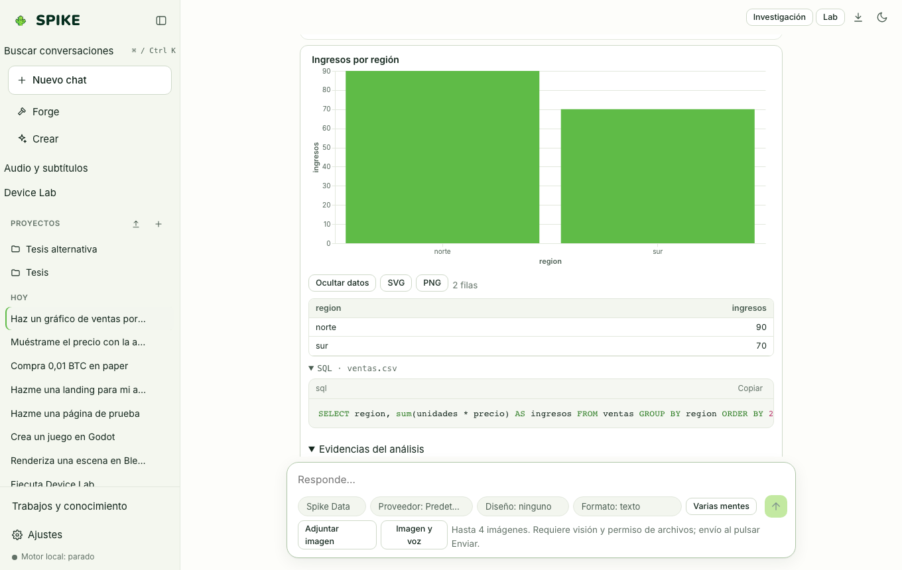

# Spike Analytics, Verified Reports, and Geo

Language: [Español](../es/analytics.md) | **English** · [Guide Index](README.md)

## What it does

Analyzes tabular files (`CSV`, `TSV`, `Parquet`, `JSON`, `Excel .xlsx`) locally using **DuckDB**, renders interactive Vega-Lite charts with SVG/PNG export, builds offline **Geo** maps (GeoJSON and point layers without external tile servers), exports reports to Word (`.docx`) and PDF, and turns project tables into editable **Data Apps** with cell-by-cell diff previews and confirmation tokens.

## Step-by-step usage

1. Upload a `.csv`, `.xlsx`, or `.parquet` file to a project or workspace and ask the **Data** specialist to query or chart it.
2. In the resulting data card, inspect the exact DuckDB SQL query, returned rows, and Vega-Lite chart (**SVG** / **PNG**).
3. Click **View report** to open the analytical evidence view—where every number is backed by its executed SQL query—or export to **Word** or **PDF**.
4. To edit table rows through a validated UI, open **Creator › Data App**, select the project file, preview the cell diff, and click approve.

## Real limits

- All numbers in analytical reports come from DuckDB SQL execution rather than model hallucination; very large files are bounded by row and byte limits.
- Geo maps use built-in offline coastline geometry and local GeoJSON/table layers without contacting external map tile servers; see [../../STATUS.md](../../STATUS.md).

## How to verify

- Run `.venv/bin/python -m pytest -q tests/test_analytics.py tests/test_analytics_reliability.py tests/test_geo.py tests/test_data_app.py`.
