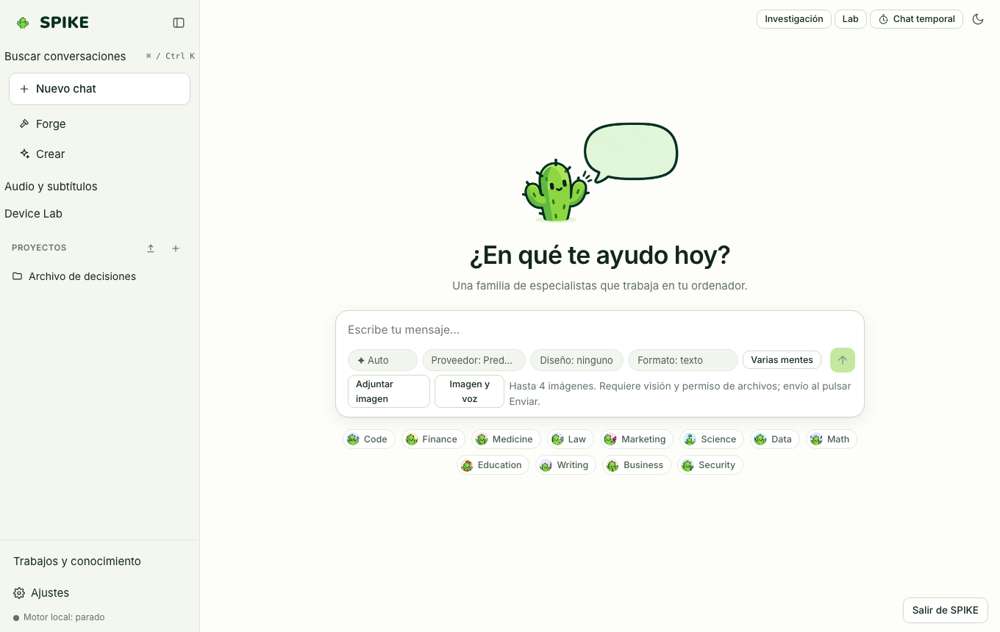

# Chat, Artifacts, and History Search

Language: [Español](../es/chat.md) | **English** · [Guide Index](README.md)

## What it does

Provides the main SSE streaming chat with automatic or manual specialist routing, tool execution governed by the permission broker, local image attachments (resized to at most 1536 px), a sandboxed artifact side panel (`sandbox="allow-scripts"` and network-blocking CSP), conversation branching, temporary chat mode (saves neither history nor memory), file checkpoints (`undo`), and full-text history search (SQLite FTS5).

## Step-by-step usage

1. Type your prompt in the main composer (`#composer-input`) and press `Enter` to send (`Shift+Enter` inserts a newline).
2. Use the **Specialist** selector above the composer to pick a specific domain or leave it on `Auto`; use the **Design** selector when generating HTML/UI.
3. When a tool requires approval (`write_file`, `run_command`, `web_fetch`, etc.), an inline permission card shows the exact arguments: click **Allow once** or **Deny**.
4. Click **Preview** on any HTML, SVG, or diagram block to open the artifact panel, inspect the preview, or attach line comments for follow-up revisions.
5. To revert file edits made during a turn, click **Undo** on that file's change, under the answer.
6. Click **Search** in the sidebar to search across past conversations and messages with highlighted snippets.

## Real limits

- Artifacts run inside a strict iframe (`sandbox="allow-scripts"`, `default-src 'none'`) without access to the parent window or the network.
- File checkpoints back up workspace files up to 50 MB for 7 days; if you edited a file manually after the turn, SPIKE reports a `409` conflict instead of overwriting your changes silently.
- Local speech-to-text (`whisper.cpp`) and text-to-speech (`piper`) require optional local binaries; see [../../STATUS.md](../../STATUS.md).

## How to verify

- Run `.venv/bin/python -m pytest -q tests/test_server.py tests/test_undo.py tests/test_history_search.py`.
- Run frontend tests: `cd web && npx vitest run src/history.test.tsx src/media.test.tsx`.
