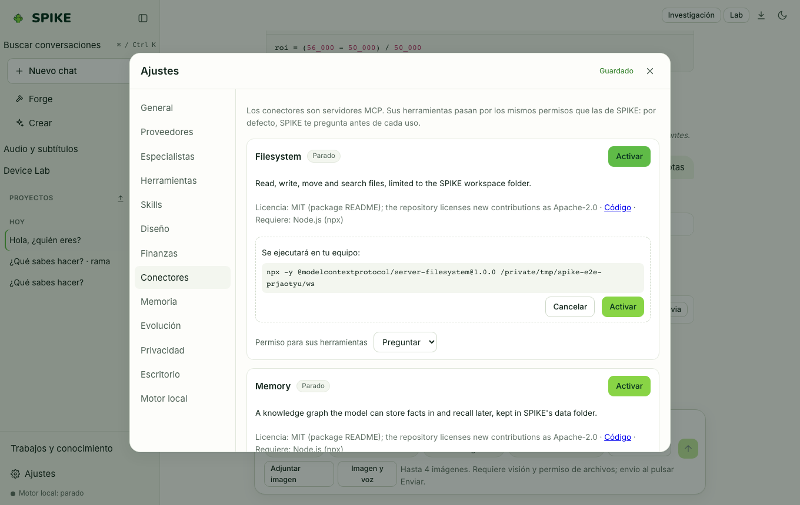

# MCP Connectors, Assisted Browser, and Desktop Actions

Language: [Español](../es/connectors.md) | **English** · [Guide Index](README.md)

## What it does

Connects SPIKE to local (`stdio`) and remote (`Streamable HTTP`) **Model Context Protocol (MCP)** servers, exposes SPIKE itself as an MCP server (`/mcp`), provides **assisted browser** automation with per-domain policies and a step recorder (`Replay`), and supports opt-in **desktop** actions (screen capture, click, type) with per-action confirmation and slam-to-corner emergency stop.

## Step-by-step usage

1. Open **Settings › Connectors** to configure built-in MCP connectors or click **Add connector** to register a custom `stdio` or `http` MCP server.
2. Enter any required credentials (stored in the OS keyring or `0600` `secrets.json`, never in SQLite), keep the tool policy on `Always ask`, and enable the connector.
3. In **Settings › Connectors › Browser domains**, set per-domain rules (`allow`, `ask`, `block`) for headless browser tools.
4. Click **Replay** in the sidebar to record browser interactions or replay a saved script with confirmation prompts.
5. In **Settings › Desktop**, desktop control is off by default; when enabled, every click/keystroke shows a coordinate preview card and stops immediately if the mouse is moved to a screen corner.

## Real limits

- Custom connectors start disabled and default to `ask` permission policy. MCP App views (`ui://`) render inside a sandboxed iframe (`sandbox="allow-scripts"`) isolated from the main app.
- MCP client and server support is verified against the official MCP SDK and local test servers, not yet against third-party desktop hosts; see [../../INTEGRATIONS.md](../../INTEGRATIONS.md) and [../../STATUS.md](../../STATUS.md).

## How to verify

- Run `.venv/bin/python -m pytest -q tests/test_mcp.py tests/test_connectors_reliability.py tests/test_browser.py tests/test_recorder.py tests/test_desktop.py`.
- Run `cd web && npx vitest run src/replay.test.tsx src/desktop.test.ts`.
