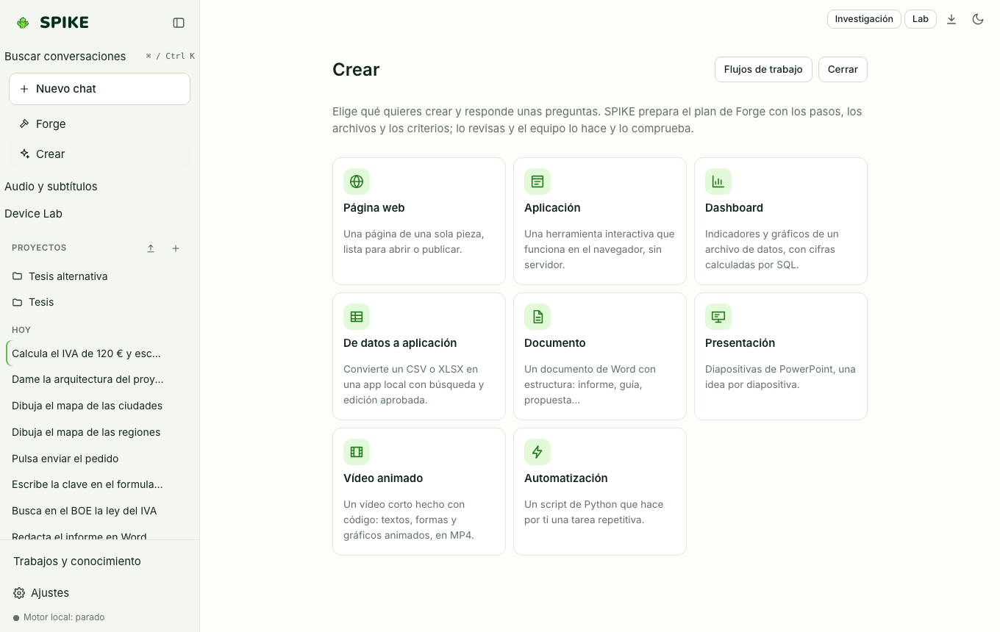

# Spike Creator, Workflows, Research Workbench, and Subtitles

Language: [Español](../es/creator.md) | **English** · [Guide Index](README.md)

## What it does

Brings together SPIKE's guided production studios: **Creator** (structured templates with editable blueprints and tabular **Data Apps**), **Workflows** (reusable multi-step pipelines with `{{var}}` inputs, conditions, and approval gates), **Research Workbench** (citation-checked notebooks over local PDFs with contradiction detection), and **Subtitle Studio** (`SRT`/`VTT` timing editor, CPS reading-speed checks, and local transcription).

## Step-by-step usage

1. Click **Creator** in the sidebar, pick a template, fill in the brief, generate and adjust the **Blueprint**, and click **Generate deliverable**.
2. Click **Workflows** in the sidebar to build a multi-step pipeline with typed inputs, step conditions, and optional output files governed by the permission broker.
3. Click **Research** to analyze local project PDFs or documents into a citation-verified notebook and compare sources for contradictions.
4. Click **Subtitles** to import `.srt` or `.vtt` captions, inspect reading-speed (CPS) warnings, edit timestamps, and export `.srt` or `.vtt`.

## Real limits

- Automatic media transcription in Subtitle Studio requires local `whisper-cli` (`whisper.cpp`) and `ffmpeg` binaries; `SRT`/`VTT` import, editing, CPS checks, and export work out of the box without extra binaries; see [../../SUBTITLES.md](../../SUBTITLES.md), [../../WORKFLOWS.md](../../WORKFLOWS.md), and [../../STATUS.md](../../STATUS.md).

## How to verify

- Run `.venv/bin/python -m pytest -q tests/test_creator.py tests/test_workflows.py tests/test_research_workbench.py tests/test_subtitles.py`.
- Run `cd web && npx vitest run src/workflowBuilder.test.tsx src/research.test.tsx src/subtitles.test.tsx`.
