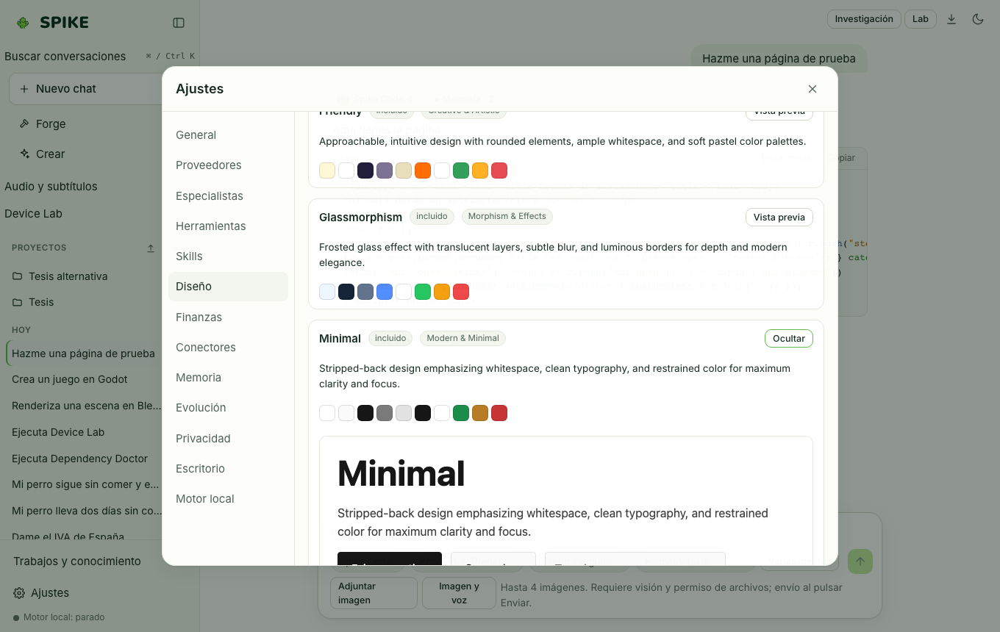

# Spike Design, Design Systems, and Reverse Studio

Language: [Español](../es/design.md) | **English** · [Guide Index](README.md)

## What it does

Provides 21 curated design systems (including the official **SPIKE** cactus palette) that inject color, typography, and layout tokens into generated HTML/CSS artifacts, supports importing custom `.zip` design packs, and includes **Reverse Studio** to turn a local or self-owned web page (after explicit ownership confirmation) into clean, editable HTML with a measured similarity score.

## Step-by-step usage

1. Select a design system in the composer's **Design** dropdown (e.g., `SPIKE` or `Minimal`) before asking for a landing page or UI component.
2. Open **Settings → Design** to browse all 21 design systems, open their live **Preview**, or import a custom `.zip` design system.
3. In **Settings → Design → Reverse Studio**, enter a URL you own or upload an HTML/screenshot file, check the ownership authorization box, and click **Generate HTML**.
4. Open the generated template in the artifact panel to inspect the clean HTML and measured similarity score.

## Real limits

- **Reverse Studio** is strictly for pages and assets you own or are licensed to modify; generation stays disabled until `authorized: true` is checked.
- Live URL rendering uses local headless Chromium when installed and falls back to static DOM extraction otherwise; see [../../REVERSE-STUDIO.md](../../REVERSE-STUDIO.md) and [../../STATUS.md](../../STATUS.md).

## How to verify

- Run `.venv/bin/python -m pytest -q tests/test_design_systems.py tests/test_reverse_studio.py`.
- Run `cd web && npx vitest run src/reverse.test.tsx`.
