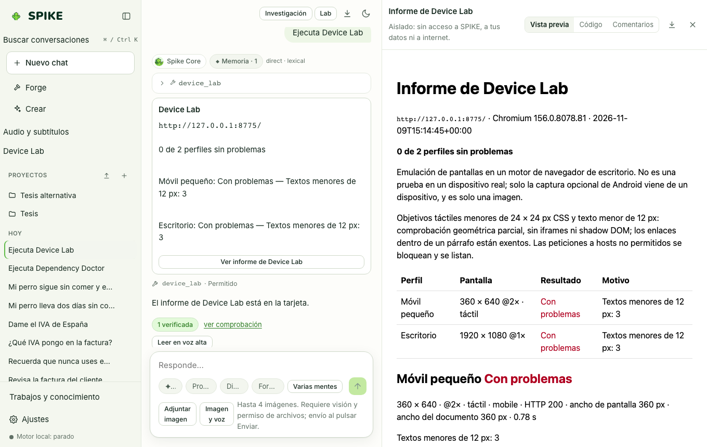

# Spike Dev and Device Lab

Language: [Español](../es/dev.md) | **English** · [Guide Index](README.md)

## What it does

Provides a terminal software-engineering loop (`spike dev`) with file editing, test execution, and checkpoints, plus **Device Lab** in the web app: a multi-viewport inspector that renders a local or approved URL in real headless Chromium across mobile, tablet, desktop, dark-mode, and 150% text-scale profiles to detect horizontal overflow, overlapping elements, small touch targets (`< 44 px`), and console errors.

## Step-by-step usage

1. For terminal coding sessions, run `.venv/bin/spike dev` inside your project directory (refuses `$HOME` or `/` unless confirmed).
2. Inside `spike dev`, use `/plan` for read-only planning, `/act` for broker-governed edits, and `/undo` to roll back a step.
3. For **Device Lab** in the web UI, click **Device Lab** in the sidebar, enter the target URL, select device profiles, check the approval box, and click **Run device check**.
4. Inspect the per-device screenshots, layout/touch-target findings, and the downloadable report.

## Real limits

- `Device Lab` requires a local Chromium installation (`CHROMIUM_PATH` or `npx playwright-core install chromium`) and explicit per-run approval (`approved: true`).
- Android hardware inspection requires `adb` and a USB-connected device with debugging enabled; see [../../DEVICE-LAB.md](../../DEVICE-LAB.md) and [../../STATUS.md](../../STATUS.md).

## How to verify

- Run `.venv/bin/python -m pytest -q tests/test_dev.py tests/test_device_lab.py tests/test_studios_reliability.py`.
- Run `cd web && npx vitest run src/deviceLab.test.tsx`.
