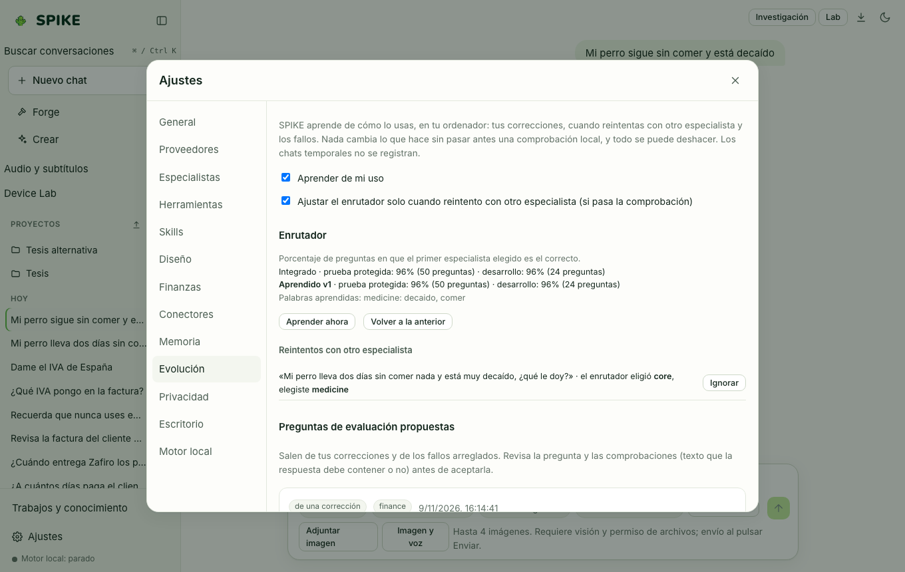

# Spike Evolution (Governed Learning and Local Evaluation)

Language: [Español](../es/evolution.md) | **English** · [Guide Index](README.md)

## What it does

Manages governed self-improvement under user control: captures explicit feedback signals (chat corrections, thumbs up/down, custom verification questions), optimizes specialist prompt variants scored against your own benchmark questions before activation, and versions LoRA adapters with one-click `rollback`.

## Step-by-step usage

1. When you correct SPIKE in chat, a **Save as learned rule?** card appears: click **Save** to keep it or **Dismiss**.
2. Open **Settings › Evolution** to inspect learned items, delete any item, or generate a sanitized issue report.
3. Add verification questions with expected answers for a specialist and click **Check now** to score the active configuration.
4. Use **Optimize instructions** to generate and score a candidate prompt variant: SPIKE only allows activation when it loses zero previously passing questions.
5. In **Personal adapter**, bookmark exemplary conversations (with secret scrubbing and exclusions) to curate a local fine-tuning dataset.

## Real limits

- No prompt variant or adapter is activated without passing the verification gate and explicit user confirmation; every installed adapter keeps its predecessor in `~/.spike/adapters/history/` for instant rollback.
- Training a personal LoRA adapter requires Apple Silicon (`mlx-lm`) or a supported GPU and never runs automatically in the background; see [../../TRAINING.md](../../TRAINING.md) and [../../STATUS.md](../../STATUS.md).

## How to verify

- Run `.venv/bin/python -m pytest -q tests/test_evolution.py tests/test_personal_adapter.py`.
- Run `cd web && npx vitest run src/evolution.test.tsx`.
