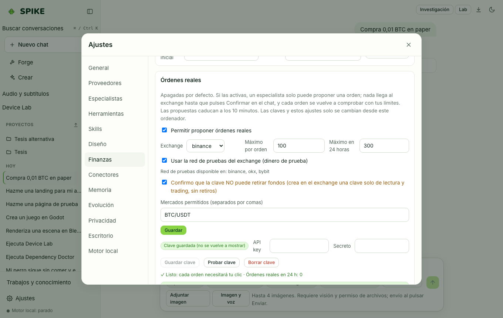

# Spike Finance in Simulated Mode (Paper Trading and Backtesting)

Language: [Español](../es/finance.md) | **English** · [Guide Index](README.md)

## What it does

Provides a local **Paper Trading** account in SQLite (simulated cash balance, market/limit orders, fees, and portfolio valuation), a **Backtesting** engine with walk-forward validation (out-of-sample split, fees, slippage, Sharpe ratio, and overfitting warnings) over local CSV candles or public market data, and a strict safety gate keeping live exchange orders disabled by default.

## Step-by-step usage

1. Select the **Finance** specialist in chat and request a simulated paper trade (e.g., `Buy 0.01 BTC on paper`) or a walk-forward backtest on a CSV candle file.
2. Open **Settings › Finance** to inspect your simulated paper balances, open/filled orders, or reset the starting cash balance.
3. In backtest result cards, inspect both the in-sample and walk-forward out-of-sample metrics alongside fee and slippage assumptions.

## Real limits

- **SPIKE Finance is simulation and analytical software, not financial or investment advice.**
- The Finance specialist currently runs as an **instruction profile (β)** on the base model: round 1 of the Finance adapter (768-token window) was **rejected** on 2026-11-09 due to a 3.00-point drop on general knowledge (max allowed drop: 1.5), and round 2 (1536-token window) is currently training; see [../../STATUS.md](../../STATUS.md).
- Real exchange orders are **off by default** (`finance.live.enabled = false`); even when enabled on the local machine with per-order and daily caps, a model can only propose an order and requires an explicit user click on the confirmation card before execution.

## How to verify

- Run `.venv/bin/python -m pytest -q tests/test_finance.py`.
