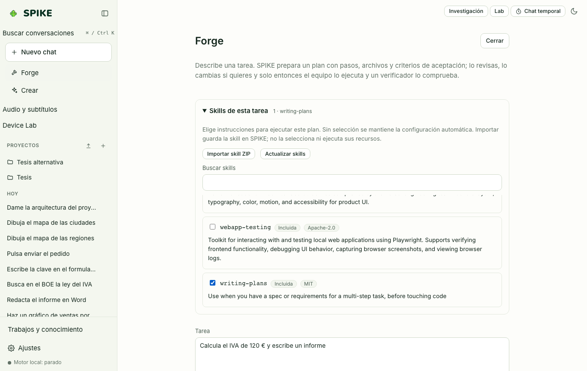

# Spike Forge and Parallel Prototypes

Language: [Español](../es/forge.md) | **English** · [Guide Index](README.md)

## What it does

Runs multi-step tasks with an explicit specialist plan, step and tool budgets, deterministic checks on saved files (Python AST/undefined-name checks, JSON/CSV parsing), and a **Parallel Prototypes** mode that runs two approaches (`A` and `B`) in isolated Git worktrees for side-by-side comparison before merging.

## Step-by-step usage

1. Click **Forge** in the sidebar to open the Forge workspace.
2. Enter the goal, expected output files (e.g., `report.md`), and optionally enable **Blueprint** review to edit or approve steps before execution.
3. Inspect each step's progress, tool calls, generated deliverables, and verifier verdict.
4. In **Parallel Prototypes**, point to a clean Git repository and describe two approaches: SPIKE runs both in isolated worktrees, compares diffs and test results, and merges nothing until you explicitly pick `A` or `B` and confirm.

## Real limits

- **Measured negative result published in [../../STATUS.md](../../STATUS.md)**: across 4 evaluation runs with the local `Qwen3.5-4B` model on the 16 GB machine (`evals/results/forge-x86-16gb-20261018/`), Forge passed **32/39** tasks vs **34/39** for the core model alone (McNemar `p ≈ 0.73`, no statistically significant gain) while taking **4–8× longer**. Forge is therefore provided for step-by-step plan inspection and worktree prototyping, and is not claimed to beat single-model inference on 4B weights.

## How to verify

- Run `.venv/bin/python -m pytest -q tests/test_forge.py tests/test_prototypes.py`.
- Run `cd web && npx vitest run src/parallel.test.ts`.
