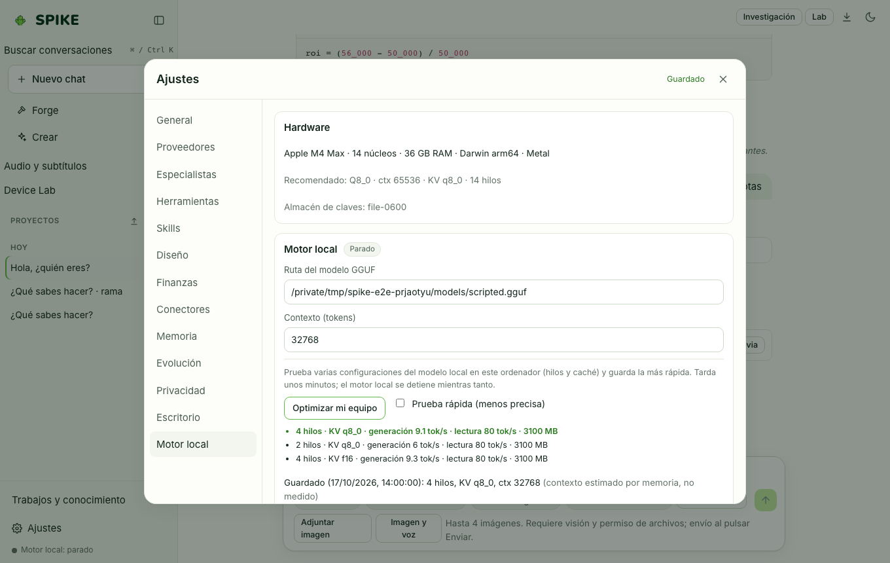

# Installation and First Run

Language: [Español](../es/installation.md) | **English** · [Guide Index](README.md)

## What it does

Installs SPIKE as a Python package with the bundled web UI, configures the local `llama-server` (llama.cpp) engine, and downloads the `Qwen3.5-4B` (`Q4_K_M`, 2.55 GiB) base model after checking its open-source license and SHA-256 digest. Desktop installers for macOS, Windows, and Linux also include a first-run setup wizard that checks free disk space (at least 6 GiB) and RAM (at least 8 GiB) before any download begins.

## Step-by-step usage

1. Clone the repository and run the one-step installer on macOS/Linux: `./install.sh` (or on Windows PowerShell: `.\install.ps1`).
2. For a manual virtual environment setup: `python3.12 -m venv .venv && .venv/bin/pip install -e ".[dev,keyring]"` and build the web UI with `cd web && npm ci && npm run build`.
3. Run `.venv/bin/spike doctor` to verify Python, `llama-server`, `~/.spike` storage, base model presence, and the secrets backend.
4. Download the verified base model with `.venv/bin/spike models pull qwen3.5-4b` (verifies the Apache-2.0 license and SHA-256 hash before placing the GGUF in `~/.spike/models/`).
5. Start the local server with `.venv/bin/spike serve` and open `http://127.0.0.1:8740` in your browser (or launch the desktop app).

## Real limits

- On a 16 GB x86 CPU-only machine (4 cores, AVX-512), `Qwen3.5-4B Q4_K_M` runs at **5.1–6.2 tok/s** up to an 8K prompt (52 s time-to-first-token at 1K; 773 s at 8K) using **3.6 GiB** of anonymous RAM (6.1 GiB peak RSS including the memory-mapped GGUF). A 32K prompt on 4 CPU cores takes ~1.5 h to the first token, so SPIKE starts CPU-only machines at an 8K context.
- On Apple Silicon M4 Max with Metal (`--gpu-layers 99`), generation runs at **80–82 tok/s** (0.86 s TTFT at 1K; 7.2 s at 8K) with 3.6 GiB RSS.
- Draft desktop installers (`.dmg`, `.exe`, `.AppImage`) do not carry paid Apple Developer ID notarization or Windows Authenticode certificates yet; see [../../STATUS.md](../../STATUS.md).

## How to verify

- Run `.venv/bin/spike doctor` and confirm that environment checks pass.
- Run the offline model and setup wizard test suite: `.venv/bin/python -m pytest -q tests/test_models.py tests/test_setup_wizard.py`.
- Run the installer smoke test without a model: `python scripts/installer_smoke.py --wheel dist/spike_ai-*.whl` (CI runs it in the `package` job). It installs the built wheel in a fresh temporary venv (the package index is used for dependencies, so it needs network), starts SPIKE with `SPIKE_HOME`, `HOME` and `SPIKE_API_TOKEN` set on a free loopback port, checks `/api/health` and `/v1/models`, stops it, deletes the temporary folder and asserts that it is gone and that the real `~/.spike` was not touched. With `--use-python <python>` it skips the install and starts an interpreter that already has SPIKE (for example the development venv).

### What the installer smoke test covers and what it does not

- It covers: the wheel contains a working server, a clean install starts, the health and OpenAI-compatible endpoints answer, the API token is enforced, and the run leaves nothing behind.
- It does not replace testing the installer on real machines, does not test the signed desktop installers (`.dmg`, `.exe`, `.AppImage`) or the native window, and does not load or download a model (it starts with `--no-local`, so `/v1/models` lists `spike-auto`, the specialists and configured providers only). `--use-python` does not test the install at all.
