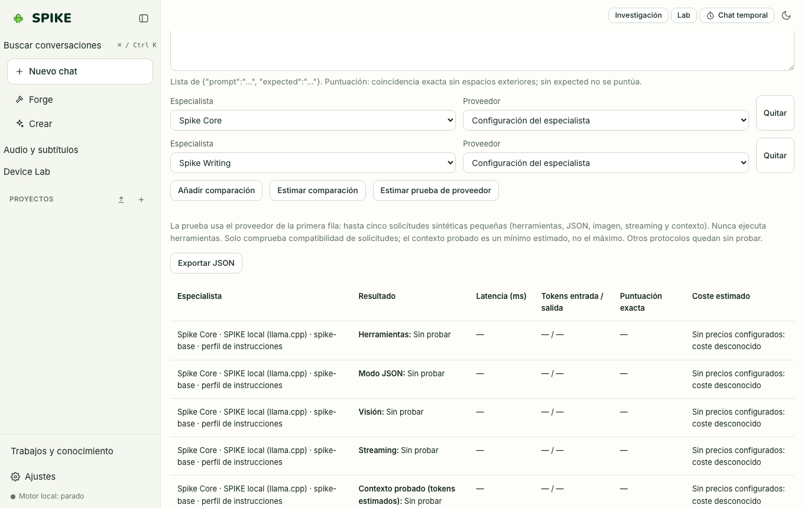

# Model Lab (A/B Model and Specialist Comparator)

Language: [Español](../es/lab.md) | **English** · [Guide Index](README.md)

## What it does

Compares side by side (up to 4 columns in parallel) how different specialists, providers, or temperature settings answer the exact same prompt, measuring time-to-first-token (TTFT), generation speed (`tok/s`), word count, and estimated cost.

## Step-by-step usage

1. Click **Lab** in the sidebar to open Model Lab.
2. Configure 2 to 4 slots (**Add slot**), choosing the provider (`spike-local` or another configured provider), specialist, and temperature for each column.
3. Enter your test prompt and click **Compare**: all columns stream in parallel and display their measured latency and token metrics.

## Real limits

- When multiple columns target the same local `llama-server`, concurrency is bounded by the local server's parallel slot configuration.
- Paid external providers remain blocked in Model Lab unless `allow_paid` is explicitly enabled for that provider in Settings; see [../../STATUS.md](../../STATUS.md).

## How to verify

- Run `.venv/bin/python -m pytest -q tests/test_lab.py`.
