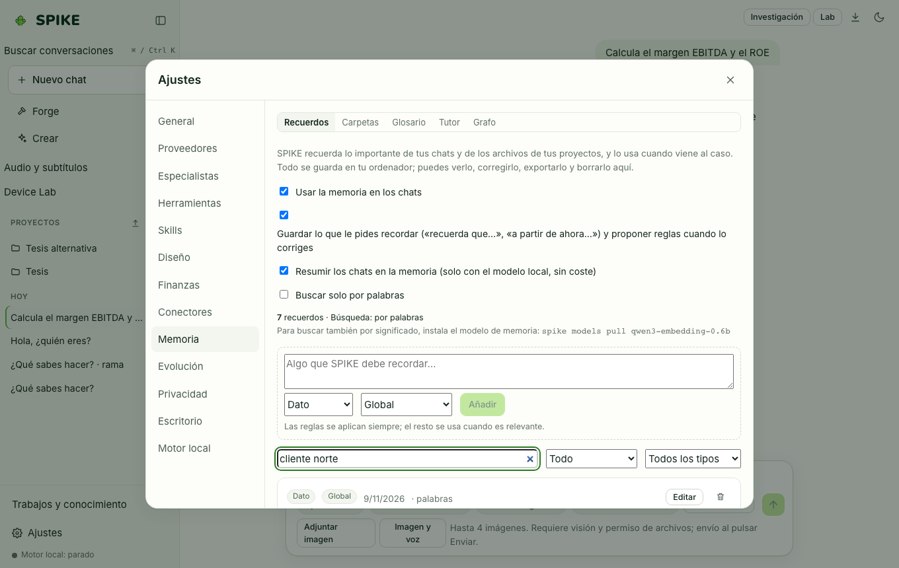

# Neural Memory, Indexed Folders, Glossary, Tutor, and Graph

Language: [Español](../es/memory.md) | **English** · [Guide Index](README.md)

## What it does

Stores persistent local knowledge in SQLite across chats: memories (`fact`, `decision`, `preference`, `rule`), opt-in indexed local folders (FTS5 word index plus optional embeddings), a terminology glossary, an SM-2 spaced-repetition study tutor, and a confirmed entity-relation knowledge graph.

## Step-by-step usage

1. Open **Settings → Memory** to add facts, preferences, decisions, or always-active rules (`rule`), filter by scope or kind, and export/import JSON.
2. In the **Folders** sub-tab, enter an absolute folder path and click **Add folder and index it**: SPIKE indexes text, Markdown, code, HTML, PDF, and Word files while skipping hidden files, `node_modules`, `.git`, virtual environments, and symlinks pointing outside the folder.
3. In **Glossary**, add terms and their required translation or definition so SPIKE enforces them whenever the term appears in chat.
4. In **Tutor**, track study topics and grade reviews (`0–5`) using SM-2 spaced repetition.
5. In **Graph**, inspect and confirm or reject proposed links between memories.

## Real limits

- Zero folders are indexed until you explicitly add one in **Settings → Memory → Folders**; forgetting a folder removes all indexed chunks and vectors from SQLite without touching your files on disk.
- Semantic vector search is optional; when no embedding model is configured, memory search operates with full SQLite FTS5 keyword matching (`words only`); see [../../STATUS.md](../../STATUS.md).

## How to verify

- Run `.venv/bin/python -m pytest -q tests/test_memory.py tests/test_memory_folders.py tests/test_glossary_tutor.py tests/test_memory_graph.py`.
