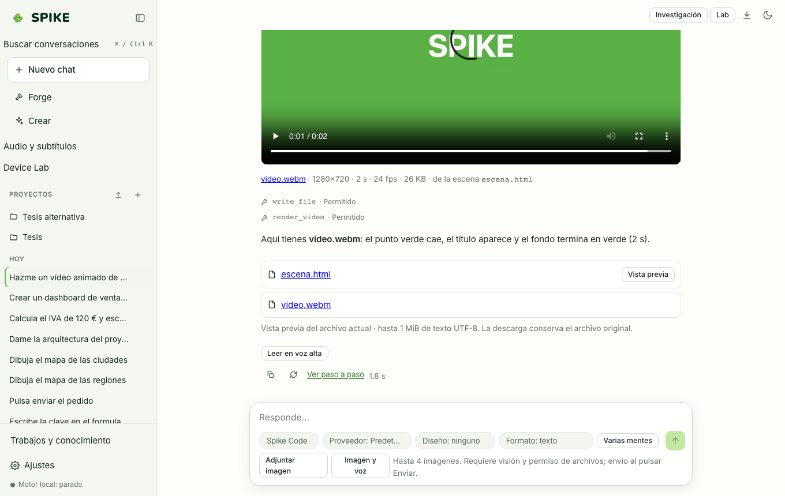

# Spike Motion, 3D Scenes, and External Engines (Blender / Godot)

Language: [Español](../es/motion.md) | **English** · [Guide Index](README.md)

## What it does

Creates declarative 2D canvas animations (`Spike Motion`, with keyframe timelines, easing curves, and video export), interactive 3D scenes, and verified bridges to local **Blender** and **Godot** installations.

## Step-by-step usage

1. Ask in chat for a motion animation (`json:motion`) or 3D scene (`json:scene3d`): SPIKE validates the specification and renders an interactive player with play, pause, and scrubber controls.
2. Use the player's export action to capture the animation into a local video file.
3. For **Blender** and **Godot** workflows, SPIKE validates the script or scene and presents a preview card before running the local engine with user permission.

## Real limits

- CLI video rendering (`spike render`) requires `ffmpeg` for MP4 output; browser export uses local `MediaRecorder`.
- Blender and Godot execution requires the official `blender` or `godot` binaries installed on the host machine; see [../../STUDIO.md](../../STUDIO.md) and [../../STATUS.md](../../STATUS.md).

## How to verify

- Run `.venv/bin/python -m pytest -q tests/test_motion.py tests/test_programs.py`.
