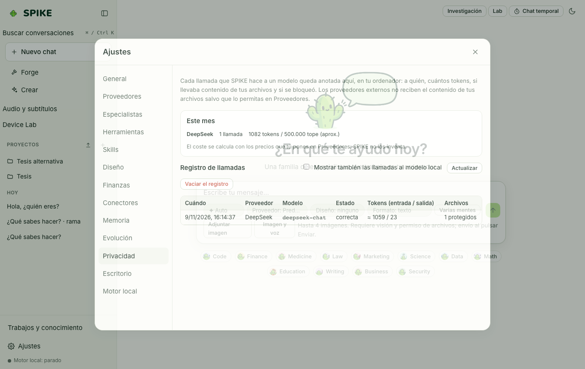

# Privacy, Sandbox, Permissions, Trust, and Spend Control

Language: [Español](../es/privacy-and-spend.md) | **English** · [Guide Index](README.md)

## What it does

Keeps SPIKE local by default, with no telemetry and no network calls you did not approve (a test checks it: see the FAQ), isolates command and Python execution in an OS **sandbox** (`sandbox-exec` on macOS, `bwrap` on Linux, Job Objects and restricted environment on Windows), gates side effects through the permission broker, verifies answer grounding (**Trust Layer** and HMAC-SHA256 `.spike-proof.json` bundles), and blocks paid providers until explicitly enabled with daily and monthly spend caps.

## Step-by-step usage

1. Open **Settings → Tools** to choose how code is isolated (**Automatic**, **Off** or **Required**) and each tool's policy (**Allow**, **Ask** or **Block**).
2. Open **Settings → Providers** to inspect local (`127.0.0.1`) vs remote/paid providers: paid providers cannot be called or receive local files unless you explicitly enable their toggles and configure spend limits. Monthly limits also count the calls still running, so calls started together stop at the same limit as calls made one after another.
3. Open **Settings → Privacy** to audit the local call log (`calls`), review per-provider token and cost totals, or clear the call log.
4. On any chat message, inspect the **Trust** badge (verifying whether numbers and citations trace back to tool outputs) or export a signed **Proof** bundle (`.spike-proof.json`) verifiable via `spike proof verify`.

## Real limits

- Strict OS namespace sandboxing on Linux requires `bubblewrap` (`bwrap`) installed on the host; when unavailable, SPIKE reports its status in Settings and enforces workspace path and environment isolation.
- External paid providers are tested in CI against local stand-in servers without live billing calls; see [../../../SECURITY.md](../../../SECURITY.md) and [../../STATUS.md](../../STATUS.md).

## How to verify

- Run `.venv/bin/python -m pytest -q tests/test_sandbox.py tests/test_security.py tests/test_trust.py tests/test_proof.py`.
- Run `cd web && npx vitest run src/trust.test.ts src/proof.test.tsx`.
