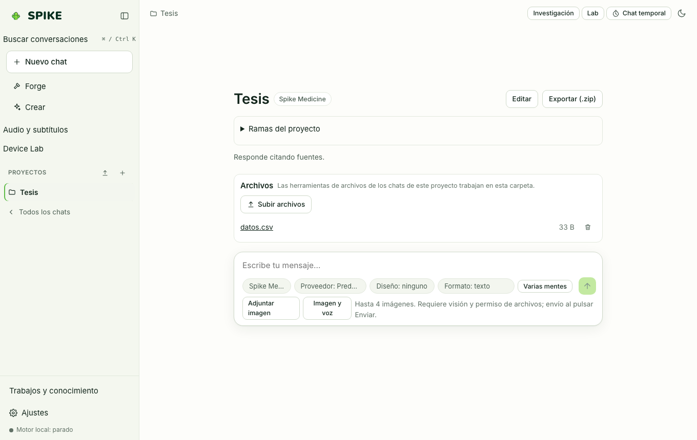

# Projects and Workspace

Language: [Español](../es/projects.md) | **English** · [Guide Index](README.md)

## What it does

Groups conversations, custom instructions, reference files, preferred design system, and project-scoped memories (`project:<id>`). Supports uploading files, browsing them in the Workspace side panel, and exporting or importing complete projects as validated `.zip` archives.

## Step-by-step usage

1. In the left sidebar, click **Projects** (or the `+` button) to create a project with a name, custom instructions, default specialist, and design system.
2. Upload reference files (Markdown, CSV, PDFs, code) into the project's isolated folder under `~/.spike/projects/<id>/files/`.
3. Click **Files** (the Workspace side panel) in the header to inspect and preview files in the workspace and active project.
4. Use **Export (.zip)** to back up the project (conversations, files, and instructions) or **Import project** to restore it.

## Real limits

- ZIP imports sanitize file paths, reject path traversal (`../`) and symlinks, and enforce size limits (`MAX_PACK_BYTES`).
- Deleting a project cascades deletion to its conversations, project files, and `project:<id>` memories; see [../../STATUS.md](../../STATUS.md).

## How to verify

- Run `.venv/bin/python -m pytest -q tests/test_projects.py tests/test_projects_memory_reliability.py`.
- Run `cd web && npx vitest run src/projectDelete.test.tsx src/workspace.test.tsx`.
