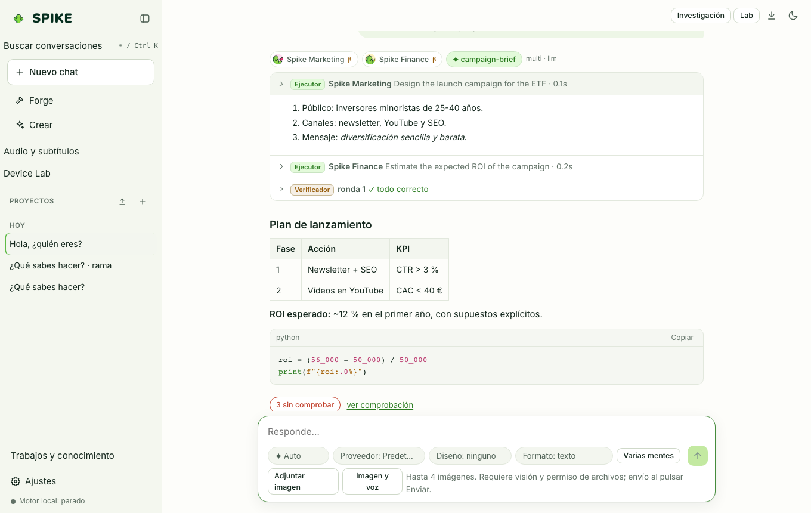

# Specialists, Router, and Multi-Mind Mode

Language: [Español](../es/specialists.md) | **English** · [Guide Index](README.md)

## What it does

SPIKE provides 13 domain specialists (`Core`, `Code`, `Finance`, `Medicine`, `Law`, `Marketing`, `Science`, `Data`, `Math`, `Education`, `Writing`, `Business`, `Security`) sharing one base model. A lexical router dispatches clear single-domain prompts without an extra LLM call (116 of 130 requests on a blind holdout set, 0.89), while **Parallel minds** answers 2 to 4 times separately (each mind can have its own specialist and provider) and shows the best answer by its check labels.

## Step-by-step usage

1. Leave the composer selector on **Auto** for lexical routing, or pick a specialist explicitly.
2. Click **Parallel minds** in the composer and choose 2 to 4 **Minds**: SPIKE shows the best answer by its check labels (more verified claims, fewer unchecked). Each mind can only read and compute.
3. Open **Settings → Specialists** to inspect each specialist's real status: whether it is currently answering as an **instruction profile (β)** on the base model or with an **evaluated, loaded LoRA adapter**, along with its active layers (base prompt, user instructions, learned instructions, and memory count).
4. In **Settings → Specialists**, you can customize per-specialist instructions or bind a specialist to a specific provider.

## Real limits

- A LoRA adapter is accepted only after passing its statistical acceptance gate without general-knowledge forgetting (max allowed drop: 1.5 points on MMLU-Pro general).
- Today **Medicine** has passed its acceptance gate (**+35.07 points** across 2,318 questions on MedMCQA, PubMedQA, and MMLU-Pro health; **−0.62 points** on general knowledge; SHA-256 `21caa0a0…`, awaiting publication). **Finance** (round 1 at 768 tokens rejected for a −3.00-point drop in general knowledge; round 2 at 1536 tokens rejected: its best checkpoint gained +7.00 on finance but lost −2.75 on general; round 3 raises the general replay share from 30% to 45%) and the remaining specialists currently run as **instruction profiles (β)** on the base model; see [../../SPECIALISTS.md](../../SPECIALISTS.md) and [../../STATUS.md](../../STATUS.md).

## How to verify

- Run `.venv/bin/python -m pytest -q tests/test_router.py tests/test_minds.py tests/test_specialist_status.py`.
- Run `cd web && npx vitest run src/specialists.test.tsx`.
