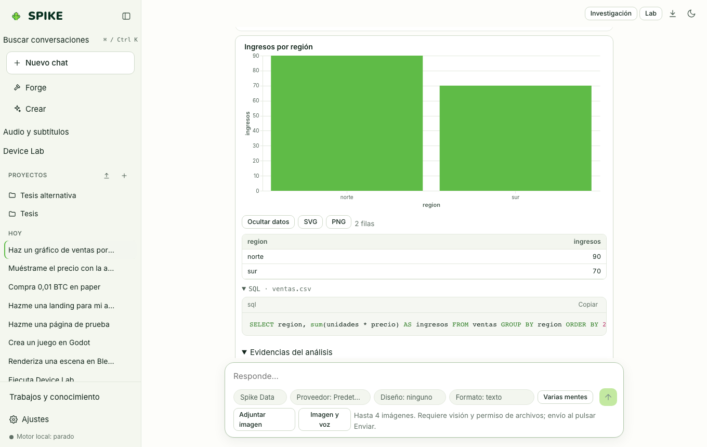

# Spike Analytics, informes verificados y Geo

Idioma: **Español** | [English](../en/analytics.md) · [Índice de la guía](README.md)

## Qué hace

Analiza hojas de cálculo y tablas (`CSV`, `TSV`, `Parquet`, `JSON`, `Excel .xlsx`) localmente con **DuckDB**, genera gráficos Vega-Lite interactivos exportables a SVG/PNG, construye mapas **Geo** (GeoJSON y capas de puntos sobre lienzo offline sin servidores de teselas externos), exporta informes a Word (`.docx`) y PDF, y permite publicar una tabla como **Data App** editable con vista previa de cambios y token de confirmación.

## Cómo se usa paso a paso

1. Sube un archivo `.csv`, `.xlsx` o `.parquet` a un proyecto o al espacio de trabajo y pide al especialista **Data** que lo explore o grafique.
2. En la tarjeta de resultados de datos, inspecciona la consulta SQL exacta ejecutada en DuckDB, las filas resultantes y el gráfico Vega-Lite (**SVG** / **PNG**).
3. Pulsa **Ver informe** para abrir la vista de evidencia analítica, donde cada cifra está vinculada a su consulta SQL real, o descárgalo en **Word** o **PDF**.
4. Para editar celdas desde una interfaz segura, abre **Creator › Data App**, elige el archivo del proyecto, previsualiza el diff celda por celda y confirma con el botón de aprobación.

## Límites reales

- Los números de los informes analíticos salen de consultas SQL ejecutadas por DuckDB, nunca inventados por el modelo; los archivos grandes se limitan por tamaño y número de filas devueltas a la interfaz.
- El lienzo cartográfico Geo renderiza costas simplificadas offline y capas locales sin descargar teselas de internet; consulta [../../STATUS.md](../../STATUS.md).

## Cómo comprobarlo

- Ejecuta `.venv/bin/python -m pytest -q tests/test_analytics.py tests/test_analytics_reliability.py tests/test_geo.py tests/test_data_app.py`.
