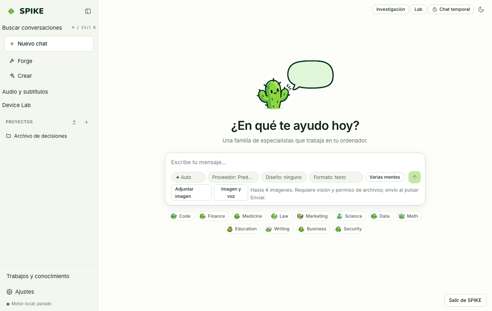

# Chat, artefactos y búsqueda en el historial

Idioma: **Español** | [English](../en/chat.md) · [Índice de la guía](README.md)

## Qué hace

Proporciona la conversación principal en streaming SSE con enrutado automático o manual a especialistas, ejecución de herramientas gobernada por el broker de permisos, adjuntos de imagen locales (hasta 1536 px), panel lateral de artefactos aislados (HTML/SVG/Mermaid/código en iframe con `sandbox="allow-scripts"` y CSP sin red), ramificación de conversaciones, modo temporal (no guarda historial ni memoria), puntos de restauración (`undo`) y búsqueda de texto completo (FTS5) en el historial.

## Cómo se usa paso a paso

1. En la pantalla principal, escribe tu consulta en el compositor (`#composer-input`) y pulsa `Enter` para enviarla (`Shift+Enter` inserta salto de línea).
2. Para elegir un especialista concreto en vez de `Auto`, usa el selector **Especialista** sobre el compositor; para aplicar un sistema visual al código generado, usa el selector **Diseño**.
3. Cuando una herramienta requiere permiso (`write_file`, `run_command`, `web_fetch`, etc.), aparece una tarjeta en el chat con los argumentos exactos: pulsa **Permitir una vez** o **Denegar**.
4. Si la respuesta incluye bloques HTML, SVG o diagramas, pulsa **Vista previa** para abrir el panel de artefactos o añadir comentarios por línea para pedir revisiones.
5. Para deshacer cambios en archivos realizados por un turno, pulsa **Deshacer este paso** en la tarjeta de archivos tocados (`Checkpoints`).
6. Para buscar en conversaciones anteriores por palabra clave, proyecto o especialista, pulsa el botón **Buscar** en la barra lateral.

## Límites reales

- Los artefactos se ejecutan en un iframe aislado (`sandbox="allow-scripts"`, `default-src 'none'`) y no tienen acceso al DOM padre ni a internet.
- Los puntos de restauración hacen copia de seguridad de archivos de hasta 50 MB dentro del espacio de trabajo y se conservan 7 días; si modificaste el archivo a mano después del turno, SPIKE avisa del conflicto (`409`) antes de sobrescribir.
- La entrada de voz (`whisper.cpp`) y lectura en voz alta (`piper`) requieren tener instalados los binarios locales opcionales; consulta [../../STATUS.md](../../STATUS.md).

## Cómo comprobarlo

- Ejecuta `.venv/bin/python -m pytest -q tests/test_server.py tests/test_undo.py tests/test_history_search.py`.
- Ejecuta las pruebas de interfaz: `cd web && npx vitest run src/history.test.tsx src/media.test.tsx`.
