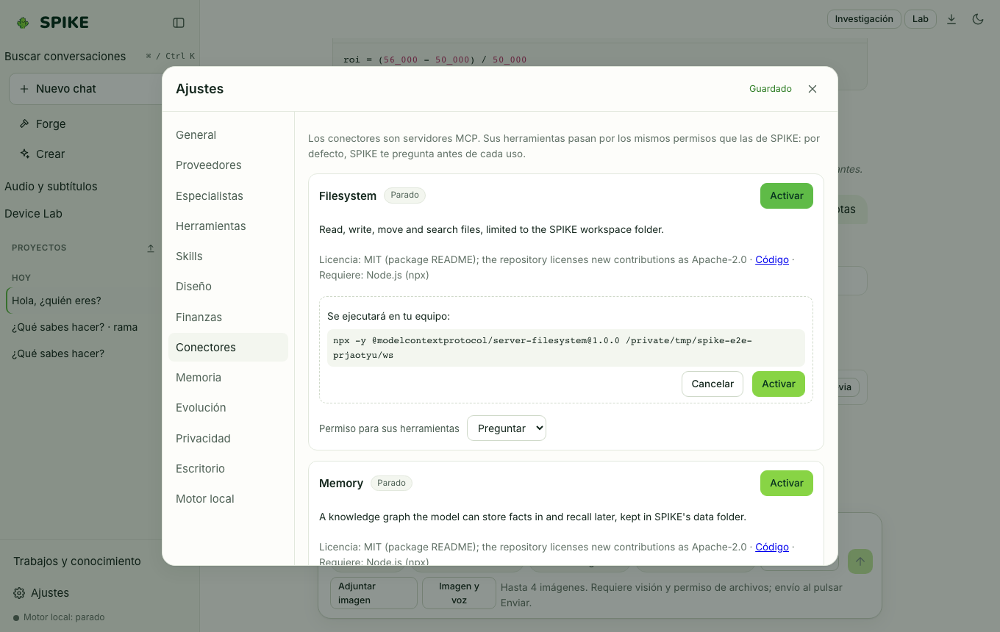

# Conectores MCP, navegador asistido y acciones de escritorio

Idioma: **Español** | [English](../en/connectors.md) · [Índice de la guía](README.md)

## Qué hace

Conecta SPIKE con servidores **Model Context Protocol (MCP)** locales (`stdio`) o remotos (`Streamable HTTP`), expone las herramientas de SPIKE como servidor MCP (`/mcp`), ofrece automatización de **navegador asistido** con reglas por dominio y grabador de flujos (`Replay`), y permite acciones de **escritorio** (captura de pantalla, clic, teclado) desactivadas por defecto y con confirmación paso a paso.

## Cómo se usa paso a paso

1. Abre **Ajustes › Conectores** para ver los conectores predefinidos o pulsa **Añadir conector** para registrar un servidor MCP por `stdio` o `http`.
2. Introduce las claves requeridas (se guardan en el llavero del sistema o en `secrets.json` con modo `0600`, nunca en SQLite), elige la política de permisos (`Preguntar siempre` por defecto) y activa el conector.
3. En **Ajustes › Conectores › Dominios del navegador**, define qué dominios están permitidos, bloqueados o requieren pregunta antes de que el navegador automatizado los visite.
4. Usa el botón **Replay** en la barra lateral para grabar pasos en tu navegador o reproducir un flujo guardado deteniéndose ante cualquier paso sensible.
5. En **Ajustes › Escritorio**, mantén desactivado el control de pantalla o actívalo con confirmación por acción y parada de emergencia moviendo el ratón a una esquina (`slam-to-corner`).

## Límites reales

- Los conectores personalizados se crean desactivados y sus herramientas tienen por defecto política `ask` (piden permiso antes de ejecutarse). Las vistas MCP Apps (`ui://`) se renderizan en un iframe con `sandbox="allow-scripts"` sin acceso al documento principal.
- El cliente y el servidor MCP están verificados contra el SDK oficial de MCP y servidores de prueba locales, aún no contra clientes externos de terceros en producción; consulta [../../INTEGRATIONS.md](../../INTEGRATIONS.md) y [../../STATUS.md](../../STATUS.md).

## Cómo comprobarlo

- Ejecuta `.venv/bin/python -m pytest -q tests/test_mcp.py tests/test_connectors_reliability.py tests/test_browser.py tests/test_recorder.py tests/test_desktop.py`.
- Ejecuta `cd web && npx vitest run src/replay.test.tsx src/desktop.test.ts`.
