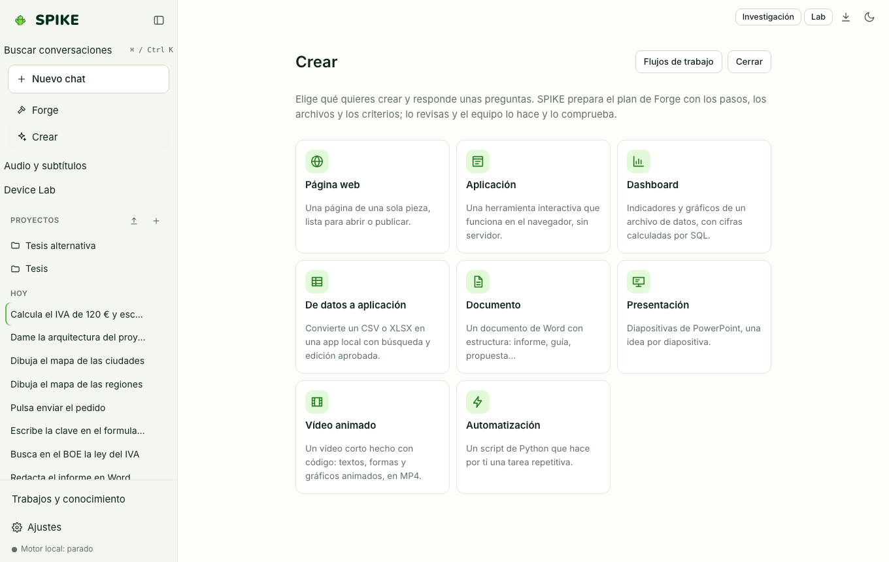

# Crear, Flujos de trabajo, Investigación y Audio y subtítulos

Idioma: **Español** | [English](../en/creator.md) · [Índice de la guía](README.md)

## Qué hace

Agrupa las herramientas de producción guiada de SPIKE: **Crear** (plantillas que se convierten en un plan de Forge que revisas antes de ejecutar, y la plantilla **De datos a aplicación** para editar tablas), **Flujos de trabajo** (pasos encadenados en un lienzo con variables `{{nombre}}` y condiciones), **Investigación** (evidencias con citas exactas comprobadas contra el documento) y **Audio y subtítulos** (edición de `SRT`/`VTT` y transcripción local).

## Cómo se usa paso a paso

1. Pulsa **Crear** en la barra lateral y elige una plantilla (página web, aplicación, dashboard, documento, presentación, vídeo animado, automatización…). Responde las preguntas y pulsa **Preparar el plan**: se abre el plan de Forge con pasos, archivos y criterios; cámbialo si quieres y pulsa **Aprobar y ejecutar**. La plantilla **De datos a aplicación** abre en su lugar una tabla editable; los cambios se revisan y se aprueban con **Aprobar escritura** antes de tocar el archivo original.
2. Dentro de **Crear**, abre **Flujos de trabajo** para encadenar entradas, especialistas, herramientas, condiciones y salidas. **Comprobar** valida el flujo antes de guardarlo o ejecutarlo, y cada herramienta pide permiso como en el chat.
3. Pulsa **Investigación** en la barra superior. Elige **Paper Rebuilder** (un PDF) o **Mapa de contradicciones** (de 2 a 4 archivos PDF, TXT o MD), pulsa **Revisar texto y destino** y después **Enviar y analizar una vez**. Solo se aceptan citas que coinciden exactamente con su fuente; puedes descargar las evidencias en JSON o revisar el plan en Forge. **Descargar cuaderno .ipynb** exporta el chat abierto sin ejecutar código.
4. Pulsa **Audio y subtítulos** en la barra lateral para importar un `.srt` o `.vtt` (o transcribir un archivo en local), corregir tiempos y textos, dividir, unir o desplazar segmentos y pulsar **Descargar**.

## Límites reales

- Investigación envía el texto mostrado al proveedor elegido en una sola solicitud, sin herramientas ni OCR: como máximo 2 MB por archivo, 80 páginas y 20.000 caracteres en total. Una cita exacta no demuestra que la interpretación sea correcta.
- La transcripción necesita `whisper.cpp` activado en el control **Imagen y voz** del chat (hasta 10 minutos y 250 MB); crear un MP4 con subtítulos incrustados necesita `ffmpeg` con libass y `ffprobe`. Importar, editar y exportar `SRT`/`VTT` funciona sin nada más. Consulta [../../SUBTITLES.md](../../SUBTITLES.md), [../../WORKFLOWS.md](../../WORKFLOWS.md) y [../../STATUS.md](../../STATUS.md).

## Cómo comprobarlo

- Ejecuta `.venv/bin/python -m pytest -q tests/test_creator.py tests/test_workflows.py tests/test_research.py tests/test_subtitles.py`.
- Ejecuta `cd web && npx vitest run src/workflowBuilder.test.tsx src/research.test.tsx src/subtitles.test.tsx`.
