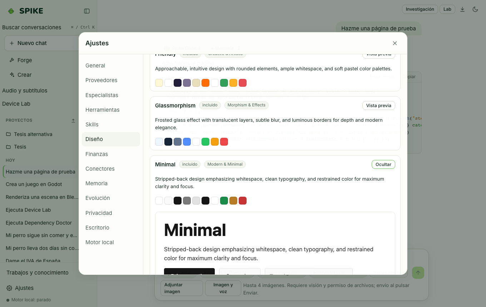

# Spike Design, sistemas de diseño y Reverse Studio

Idioma: **Español** | [English](../en/design.md) · [Índice de la guía](README.md)

## Qué hace

Reúne 21 sistemas de diseño curados (incluyendo el tema oficial de **SPIKE** con la paleta del cactus) que inyectan tokens tipográficos, colores y reglas de composición al generar interfaces HTML/CSS, permite importar sistemas propios en `.zip` y ofrece **Reverse Studio** para convertir una página local o propia (tras confirmar su titularidad) en una plantilla HTML limpia con puntuación de similitud visual.

## Cómo se usa paso a paso

1. En el compositor del chat (o en la configuración de un proyecto), selecciona un sistema en el desplegable **Diseño** (por ejemplo `SPIKE` o `Minimal`) antes de pedir una página o componente.
2. Abre **Ajustes → Diseño** para explorar las tarjetas de los 21 sistemas, abrir su **Vista previa** en vivo o importar un paquete `.zip` con tus propios tokens.
3. En **Ajustes → Diseño → Reverse Studio**, introduce la URL de una página tuya o sube un archivo HTML/captura, marca la casilla de confirmación de titularidad y pulsa **Generar HTML**.
4. Abre el resultado en el panel de artefactos para inspeccionar el código limpio y la puntuación de similitud estructural/visual.

## Límites reales

- **Reverse Studio** está diseñado exclusivamente para páginas y activos propios o con licencia explícita; el botón de generación permanece deshabilitado hasta marcar la confirmación de autorización (`authorized: true`), y la prohibición de ingeniería inversa de aplicaciones de terceros se aplica siempre.
- La captura visual en vivo de URLs en Reverse Studio usa Chromium local si está disponible y recurre al analizador DOM estático en caso contrario; consulta [../../REVERSE-STUDIO.md](../../REVERSE-STUDIO.md) y [../../STATUS.md](../../STATUS.md).

## Cómo comprobarlo

- Ejecuta `.venv/bin/python -m pytest -q tests/test_design_systems.py tests/test_reverse_studio.py`.
- Ejecuta `cd web && npx vitest run src/reverse.test.tsx`.
