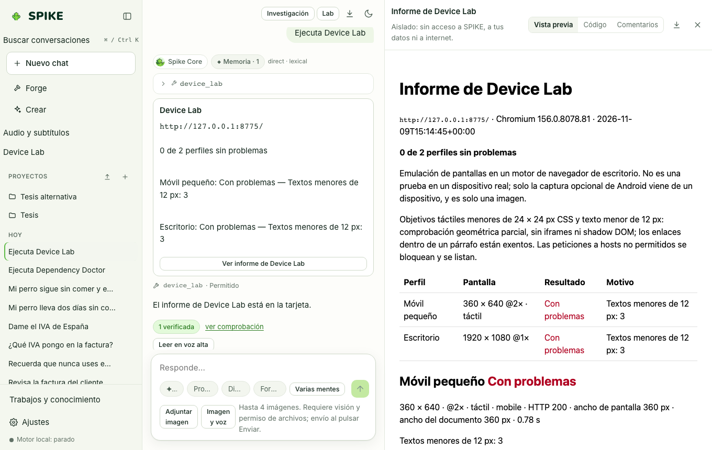

# Spike Dev y Device Lab

Idioma: **Español** | [English](../en/dev.md) · [Índice de la guía](README.md)

## Qué hace

Ofrece un bucle de ingeniería de software en terminal (`spike dev`) con lectura/edición de código, ejecución de tests y puntos de restauración, además de **Device Lab** en la aplicación web: un laboratorio que abre una URL local o aprobada en Chromium real bajo perfiles de móvil, tableta y escritorio (claro, oscuro, texto al 150 %, ventana estrecha) para detectar desbordamientos horizontales, solapamientos, botones táctiles pequeños (`< 44 px`) y errores de consola.

## Cómo se usa paso a paso

1. Para sesiones de código en terminal, ejecuta `.venv/bin/spike dev` dentro de tu carpeta de trabajo (bloquea arrancar directamente sobre `$HOME` o `/` sin confirmación).
2. Durante la sesión de `spike dev`, usa `/plan` para pedir una propuesta sin tocar archivos, `/act` para permitir ediciones con permiso y `/undo` para revertir el último paso.
3. En la aplicación, **Sesiones Dev** (barra lateral o Ctrl/Cmd+K) abre el mismo agente sobre una carpeta: cada edición y cada comando piden permiso en una tarjeta. A la derecha (debajo, en el móvil) está el **espacio de tarea**: el plan, cada acción con el permiso que recibió, los archivos cambiados con **Deshacer el último cambio** y los entregables. Al reanudar una sesión guardada se rehace con lo guardado: no se pregunta ni se ejecuta nada otra vez.
4. Para **Device Lab** en la web, pulsa **Device Lab** en la barra lateral, escribe la URL a inspeccionar, elige los perfiles de dispositivo y marca la casilla de confirmación antes de pulsar **Probar dispositivos**.
5. Revisa las capturas reales por perfil, la lista de hallazgos de diseño/accesibilidad y el informe exportable.

## Límites reales

- `Device Lab` requiere tener instalado Chromium para Playwright (`CHROMIUM_PATH` o `npx playwright-core install chromium`) y confirmación explícita en cada ejecución (`approved: true`).
- La inspección en dispositivo Android físico requiere `adb` instalado y un dispositivo conectado por USB con depuración activada; consulta [../../DEVICE-LAB.md](../../DEVICE-LAB.md) y [../../STATUS.md](../../STATUS.md).

## Cómo comprobarlo

- Ejecuta `.venv/bin/python -m pytest -q tests/test_dev.py tests/test_device_lab.py tests/test_studios_reliability.py`.
- Ejecuta `cd web && npx vitest run src/deviceLab.test.tsx`.
