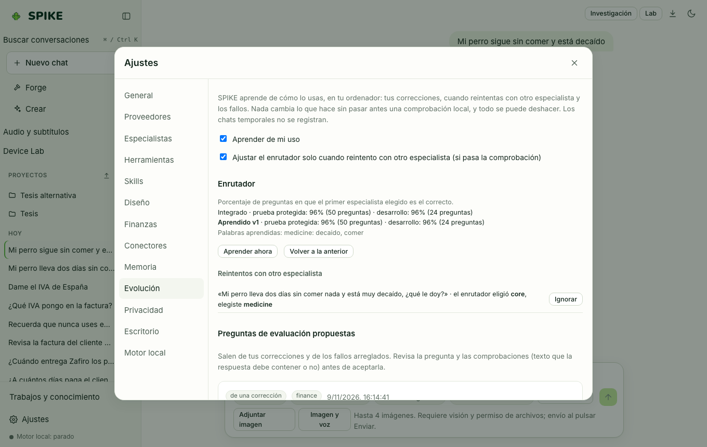

# Spike Evolution (aprendizaje gobernado y evaluación local)

Idioma: **Español** | [English](../en/evolution.md) · [Índice de la guía](README.md)

## Qué hace

Gestiona la mejora continua de SPIKE bajo control del usuario: recoge señales explícitas (correcciones en el chat, valoraciones positivas/negativas, preguntas de verificación propias), optimiza variantes de instrucciones por especialista evaluándolas contra tus propias preguntas de control antes de activarlas, y permite instalar o revertir (`rollback`) versiones de adaptadores LoRA verificados.

## Cómo se usa paso a paso

1. Cuando corriges a SPIKE en el chat, aparece una tarjeta **¿Guardar como regla aprendida?**: pulsa **Guardar** para conservarla o **Descartar**.
2. Abre **Ajustes › Evolución** para revisar la cola de elementos aprendidos, eliminar cualquiera con un clic o exportar un informe anonimizado.
3. Añade preguntas de comprobación con su respuesta esperada para un especialista y pulsa **Comprobar ahora** para medir cuántos aciertos obtiene la configuración actual.
4. Usa **Probar mejora de instrucciones** para que SPIKE proponga un candidato y lo evalúe contra tus preguntas: solo se puede activar si iguala o mejora la puntuación anterior sin perder ninguna pregunta que ya pasaba.
5. En **Adaptador personal**, marca conversaciones ejemplares (con filtro automático de secretos y exclusiones) para preparar un conjunto de entrenamiento local.

## Límites reales

- Ningún cambio de instrucciones ni adaptador se activa automáticamente sin pasar las preguntas de verificación y sin acción del usuario; cualquier versión instalada guarda su copia previa en `~/.spike/adapters/history/` para poder hacer `rollback` inmediato.
- El entrenamiento de un adaptador personal requiere Apple Silicon (`mlx-lm`) o GPU compatible y nunca se lanza en segundo plano sin orden explícita; consulta [../../TRAINING.md](../../TRAINING.md) y [../../STATUS.md](../../STATUS.md).

## Cómo comprobarlo

- Ejecuta `.venv/bin/python -m pytest -q tests/test_evolution.py tests/test_personal_adapter.py`.
- Ejecuta `cd web && npx vitest run src/evolution.test.tsx`.
