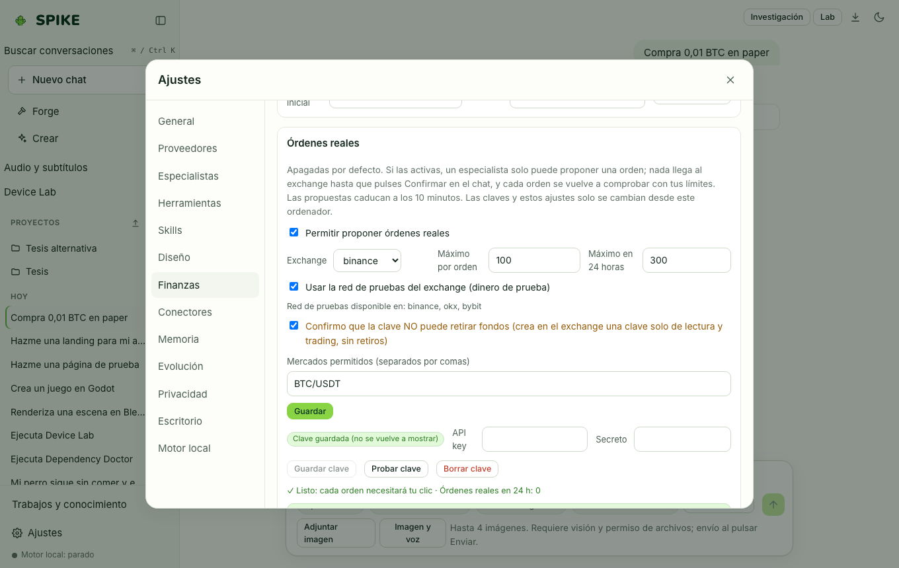

# Spike Finance en modo simulado (Paper Trading y Backtesting)

Idioma: **Español** | [English](../en/finance.md) · [Índice de la guía](README.md)

## Qué hace

Incluye una cuenta de **Paper Trading** (cartera simulada local en SQLite con efectivo inicial, órdenes de mercado/límite, comisiones y valoración), un motor de **Backtesting** con validación *walk-forward* (entrenamiento/prueba separados, comisiones, *slippage* y ratio de Sharpe con aviso anti-sobreajuste) sobre velas CSV locales o datos públicos de mercado, y una barrera estricta que mantiene las órdenes reales desactivadas por defecto.

## Cómo se usa paso a paso

1. Elige el especialista **Finance** en el chat y pide una operación en cuenta simulada (por ejemplo: `Compra 0,01 BTC en paper`) o un análisis/backtest sobre un CSV de velas.
2. Abre **Ajustes → Finanzas** para ver el saldo de tu cartera simulada (`Paper`), las órdenes abiertas/ejecutadas o reiniciar el saldo inicial (`Reset`).
3. En los informes de backtesting del chat, revisa la separación entre el periodo de ajuste (*in-sample*) y el periodo fuera de muestra (*walk-forward test*), junto con las comisiones aplicadas.

## Límites reales

- **Esto es software de análisis y simulación financiera, no asesoramiento de inversión.**
- El especialista de Finanzas responde hoy como **perfil de instrucciones (β)** sobre el modelo base: la ronda 1 del adaptador (ventana de 768 tokens) fue **rechazada** el 2026-11-09 porque perdió 3,00 puntos en conocimiento general (límite: 1,5), y la ronda 2 (ventana de 1536 tokens) está en entrenamiento; consulta [../../STATUS.md](../../STATUS.md).
- Las órdenes reales en un exchange están **desactivadas por defecto** (`finance.live.enabled = false`); incluso si el usuario las configura desde su propio equipo con límites por orden y por día, el modelo solo puede proponer una orden y requiere un clic explícito del usuario en la tarjeta de confirmación antes de enviarse.

## Cómo comprobarlo

- Ejecuta `.venv/bin/python -m pytest -q tests/test_finance.py`.
