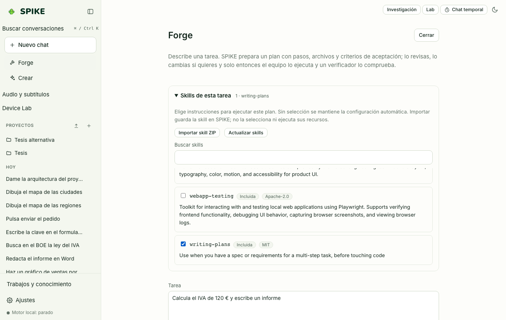

# Spike Forge y Prototipos Paralelos

Idioma: **Español** | [English](../en/forge.md) · [Índice de la guía](README.md)

## Qué hace

Ejecuta tareas de varios pasos con un plan explícito de especialistas, presupuestos de rondas y herramientas, verificaciones deterministas sobre los archivos guardados (sintaxis Python, nombres no definidos, validez JSON/CSV) y un modo de **Prototipos Paralelos** que ejecuta dos enfoques (`A` y `B`) en árboles de trabajo Git aislados (`git worktree`) para compararlos antes de fusionar.

## Cómo se usa paso a paso

1. Pulsa **Forge** en la barra lateral para abrir el banco de trabajo.
2. Escribe el objetivo, los archivos esperados (por ejemplo `informe.md`) y elige si quieres revisar el plan antes de ejecutarlo (**Blueprint**).
3. Sigue en directo cada paso del plan, las herramientas invocadas, los artefactos creados y el veredicto del verificador.
4. En la pestaña **Prototipos Paralelos**, indica un repositorio Git limpio y dos enfoques distintos: SPIKE crea dos worktrees aislados, ejecuta ambos con las mismas comprobaciones y muestra el diff lado a lado; nada se fusiona en tu rama hasta que eliges `A` o `B` y confirmas.

## Límites reales

- **Resultado negativo medido y publicado en [../../STATUS.md](../../STATUS.md)**: en las 4 tandas de evaluación con el modelo local `Qwen3.5-4B` en la máquina de 16 GB (`evals/results/forge-x86-16gb-20261018/`), Forge obtuvo **32/39** tareas válidas frente a **34/39** del modelo base solo (McNemar `p ≈ 0,73`, sin mejora estadísticamente significativa) tardando **4–8× más tiempo**. Por ello, Forge se documenta con transparencia como herramienta de planificación e inspección paso a paso, sin afirmar que supere al modelo en solitario con pesos 4B.

## Cómo comprobarlo

- Ejecuta `.venv/bin/python -m pytest -q tests/test_forge.py tests/test_prototypes.py`.
- Ejecuta `cd web && npx vitest run src/parallel.test.ts`.
