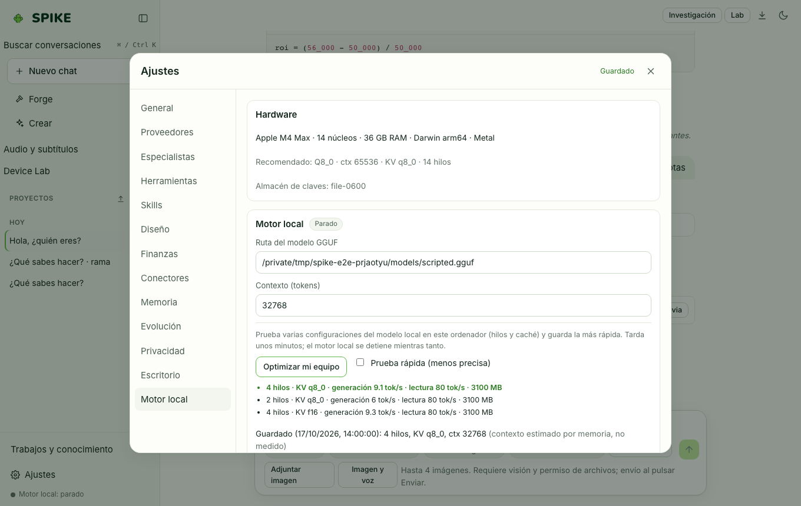

# Instalación y primer arranque

Idioma: **Español** | [English](../en/installation.md) · [Índice de la guía](README.md)

## Qué hace

Instala SPIKE como paquete Python junto con la interfaz web compilada, prepara el motor local `llama-server` (llama.cpp) y descarga de forma verificada (SHA-256 y licencia abierta) el modelo base `Qwen3.5-4B` (`Q4_K_M`, 2,55 GiB). También ofrece instaladores de escritorio para macOS, Windows y Linux con un asistente de primer arranque que comprueba disco libre (mínimo 6 GiB) y memoria RAM (mínimo 8 GiB) antes de iniciar cualquier descarga.

## Cómo se usa paso a paso

1. Clona el repositorio y ejecuta el instalador rápido en macOS/Linux: `./install.sh` (o en Windows PowerShell: `.\install.ps1`).
2. Para instalación manual en entorno virtual: `python3.12 -m venv .venv && .venv/bin/pip install -e ".[dev,keyring]"` y compila la interfaz con `cd web && npm ci && npm run build`.
3. Comprueba el entorno local con `.venv/bin/spike doctor`: revisa Python, versión de `llama-server`, espacio en `~/.spike`, estado del modelo base y secretos.
4. Descarga el modelo base verificado con `.venv/bin/spike models pull qwen3.5-4b` (comprueba licencia Apache-2.0 y hash SHA-256 antes de mover el archivo a `~/.spike/models/`).
5. Inicia el servidor local con `.venv/bin/spike serve` y abre `http://127.0.0.1:8741` en el navegador (o usa el lanzador de escritorio si instalaste el paquete nativo).

## Límites reales

- En una máquina de 16 GB x86 solo con CPU (4 núcleos, AVX-512), `Qwen3.5-4B Q4_K_M` genera a **5,1–6,2 tok/s** hasta 8K tokens de contexto (52 s hasta la primera palabra a 1K; 773 s a 8K) usando **3,6 GiB** de memoria anónima (6,1 GiB RSS con el archivo mapeado). Un contexto de 32K en CPU tarda ~1,5 h hasta la primera palabra, por lo que SPIKE inicia equipos solo CPU con ventana de 8K.
- En Apple Silicon M4 Max con Metal (`--gpu-layers 99`), genera a **80–82 tok/s** (0,86 s hasta la primera palabra a 1K; 7,2 s a 8K) con 3,6 GiB RSS.
- Los instaladores candidatos (`.dmg`, `.exe`, `.AppImage`) aún no cuentan con firma de pago de Apple Developer ID ni certificado Authenticode en Windows; consulta [../../STATUS.md](../../STATUS.md).

## Cómo comprobarlo

- Ejecuta `.venv/bin/spike doctor` y confirma que todos los controles obligatorios aparecen en estado `ok` o con su aviso esperado si aún no descargaste el modelo.
- Verifica las pruebas de instalación y primer arranque sin red: `.venv/bin/python -m pytest -q tests/test_models.py tests/test_setup_wizard.py`.
- Ejecuta la prueba de humo del instalador sin modelo: `python scripts/installer_smoke.py --wheel dist/spike_ai-*.whl` (la CI la ejecuta en el trabajo `package`). Instala el wheel compilado en un venv temporal nuevo (usa el índice de paquetes para las dependencias, así que necesita red), arranca SPIKE con `SPIKE_HOME`, `HOME` y `SPIKE_API_TOKEN` en un puerto libre de loopback, comprueba `/api/health` y `/v1/models`, lo detiene, borra la carpeta temporal y verifica que ya no existe y que el `~/.spike` real no se ha tocado. Con `--use-python <python>` omite la instalación y arranca un intérprete que ya tiene SPIKE (por ejemplo el venv de desarrollo).

### Qué cubre la prueba de humo del instalador y qué no

- Cubre: que el wheel contiene un servidor que funciona, que una instalación limpia arranca, que responden la salud y los endpoints compatibles con OpenAI, que se exige el token de la API y que la ejecución no deja nada.
- No sustituye a I3 (el instalador probado en máquinas reales), no prueba los instaladores de escritorio firmados (`.dmg`, `.exe`, `.AppImage`) ni la ventana nativa, y no carga ni descarga ningún modelo (arranca con `--no-local`, así que `/v1/models` lista solo `spike-auto`, los especialistas y los proveedores configurados). `--use-python` no prueba la instalación.
