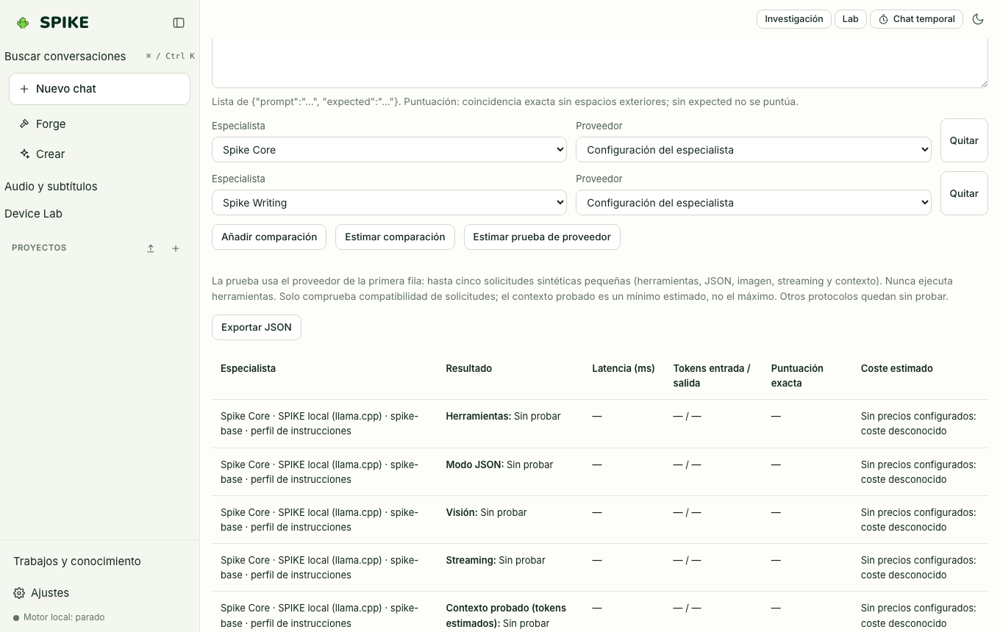

# Model Lab (comparador A/B de modelos y especialistas)

Idioma: **Español** | [English](../en/lab.md) · [Índice de la guía](README.md)

## Qué hace

Compara lado a lado (hasta 4 columnas en paralelo) cómo responden distintos especialistas, proveedores o temperaturas a la misma pregunta, midiendo en tiempo real la latencia hasta la primera palabra (TTFT), los tokens por segundo (`tok/s`), el recuento de palabras y el coste estimado.

## Cómo se usa paso a paso

1. Pulsa **Lab** en la barra lateral para abrir el comparador.
2. Añade de 2 a 4 ranuras (**Añadir columna**) y elige para cada una el proveedor (`spike-local` u otro configurado), el especialista y la temperatura.
3. Escribe el prompt de prueba y pulsa **Comparar**: todas las columnas reciben el mismo mensaje y transmiten su respuesta en paralelo con sus métricas medidas al pie de cada tarjeta.

## Límites reales

- Cuando varias columnas apuntan al mismo `llama-server` local, el tiempo total depende del número de ranuras paralelas configuradas en el servidor local.
- Los proveedores de pago siguen bloqueados en el Lab a menos que hayas activado explícitamente `allow_paid` para ese proveedor en Ajustes; consulta [../../STATUS.md](../../STATUS.md).

## Cómo comprobarlo

- Ejecuta `.venv/bin/python -m pytest -q tests/test_lab.py`.
