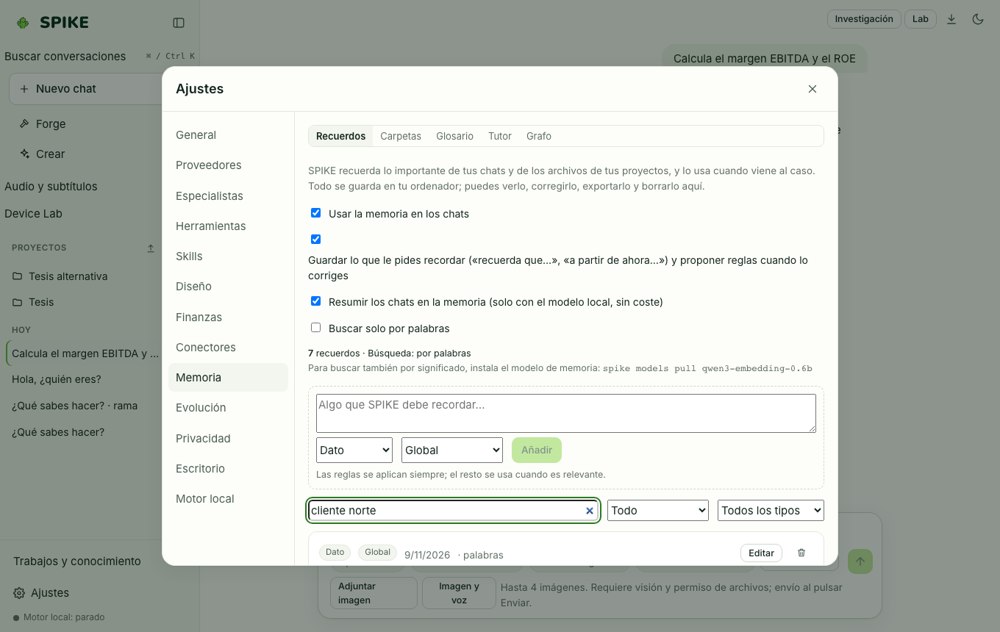

# Memoria neuronal, carpetas indexadas, glosario, tutor y grafo

Idioma: **Español** | [English](../en/memory.md) · [Índice de la guía](README.md)

## Qué hace

Almacena en SQLite local lo que SPIKE debe recordar entre conversaciones: notas (`fact`, `decision`, `preference`, `rule`), carpetas locales elegidas explícitamente por el usuario (con índice FTS5 y vectores opcionales), glosario de términos obligatorios, tutor de estudio con repetición espaciada (SM-2) y grafo de entidades y relaciones confirmadas.

## Cómo se usa paso a paso

1. Abre **Ajustes → Memoria** para añadir notas manuales o reglas (`rule`, que se inyectan siempre), filtrarlas por texto, tipo o proyecto, y exportarlas/importarlas en JSON.
2. En la subpestaña **Carpetas**, introduce la ruta absoluta de una carpeta de tu ordenador y pulsa **Añadir carpeta e indexar**: SPIKE indexa texto, Markdown, código, HTML, PDF y Word, ignorando archivos ocultos, `node_modules`, `.git`, entornos virtuales y enlaces simbólicos que salgan de la carpeta.
3. En **Glosario**, define términos y su traducción o definición obligatoria por idioma/proyecto: cuando el término aparece en el chat, SPIKE lo inyecta como regla.
4. En **Tutor**, añade temas de estudio y califica tus repasos (`0–5`) para programar la siguiente fecha con el algoritmo SM-2.
5. En **Grafo**, revisa y confirma o descarta las relaciones propuestas entre tus notas.

## Límites reales

- Nada se indexa automáticamente hasta que añades una carpeta en **Ajustes → Memoria → Carpetas**; olvidar una carpeta borra de la memoria todos sus documentos, fragmentos, índice de palabras y vectores sin tocar tus archivos en disco.
- La búsqueda por significado (vectores) requiere un endpoint local de embeddings o el paquete opcional de embeddings; sin él, la memoria funciona al 100 % por búsqueda léxica FTS5 (`words only`); consulta [../../STATUS.md](../../STATUS.md).

## Cómo comprobarlo

- Ejecuta `.venv/bin/python -m pytest -q tests/test_memory.py tests/test_memory_folders.py tests/test_glossary_tutor.py tests/test_memory_graph.py`.
