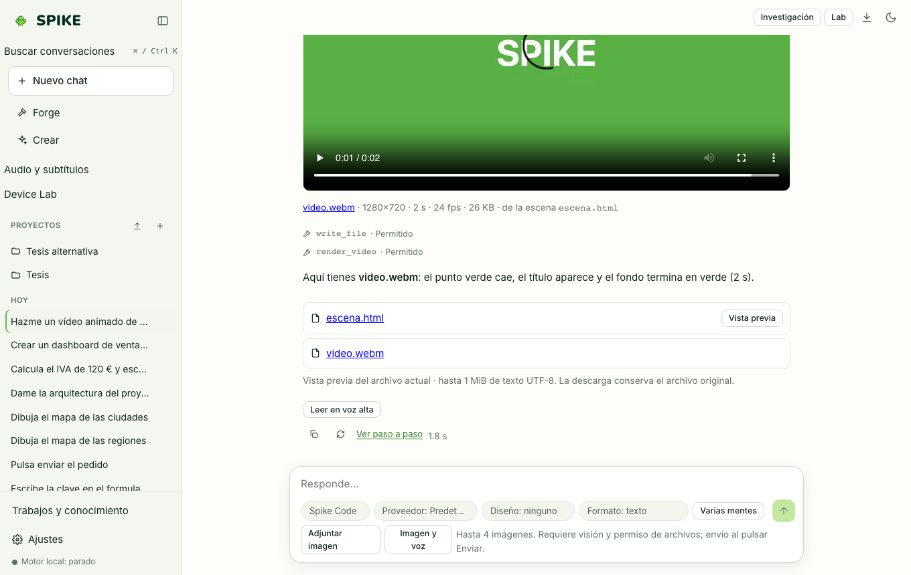

# Spike Motion, escenas 3D y motores externos (Blender / Godot)

Idioma: **Español** | [English](../en/motion.md) · [Índice de la guía](README.md)

## Qué hace

Permite crear animaciones declarativas 2D en lienzo (`Spike Motion`, con líneas de tiempo, interpolaciones `ease` y exportación a vídeo WebM/MP4), escenas 3D interactivas sobre WebGL y puentes verificados hacia **Blender** y **Godot** cuando están instalados en el ordenador.

## Cómo se usa paso a paso

1. Pide en el chat una animación (`json:motion`) o una escena 3D (`json:scene3d`): SPIKE valida la escena y muestra el reproductor interactivo con controles de reproducción, pausa y línea de tiempo.
2. Usa el botón de exportación del reproductor para grabar los fotogramas de la animación en un archivo de vídeo.
3. Para proyectos con **Blender** o **Godot**, SPIKE comprueba primero el script o la escena y muestra una tarjeta de vista previa antes de ejecutar el renderizado local bajo permiso del usuario.

## Límites reales

- La exportación de vídeo por línea de comandos (`spike render`) requiere `ffmpeg` para MP4; en el navegador se usa `MediaRecorder` local.
- Las integraciones con Blender y Godot requieren tener instalados los binarios oficiales de `blender` o `godot` en el sistema; sin ellos, SPIKE valida la estructura del proyecto sin ejecutar el binario; consulta [../../STUDIO.md](../../STUDIO.md) y [../../STATUS.md](../../STATUS.md).

## Cómo comprobarlo

- Ejecuta `.venv/bin/python -m pytest -q tests/test_motion.py tests/test_programs.py`.
