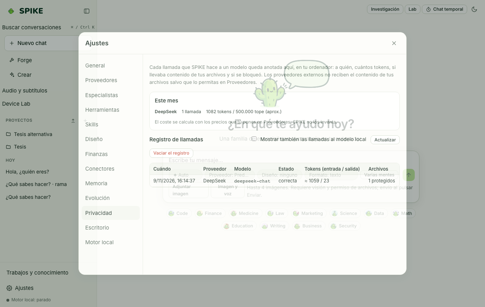

# Privacidad, sandbox, permisos, confianza y control de gasto

Idioma: **Español** | [English](../en/privacy-and-spend.md) · [Índice de la guía](README.md)

## Qué hace

Hace que SPIKE funcione en local por defecto, sin telemetría ni llamadas de red que no hayas aprobado (lo comprueba un test: ver las preguntas frecuentes), aísla la ejecución de comandos y Python en un **sandbox** de sistema operativo (`sandbox-exec` en macOS, `bwrap` en Linux, Job Objects + entorno restringido en Windows), exige permiso antes de efectos laterales, verifica la evidencia de las respuestas (**Trust Layer** y paquetes `.spike-proof.json` firmados con HMAC-SHA256) y bloquea proveedores de pago hasta que los autorices con topes diarios y mensuales.

## Cómo se usa paso a paso

1. Abre **Ajustes → Herramientas** para elegir el aislamiento del código (**Automático**, **Desactivado** u **Obligatorio**) y la política de cada herramienta (**Permitir**, **Preguntar** o **Bloquear**).
2. Abre **Ajustes → Proveedores** para ver qué proveedores son locales (`127.0.0.1`) y cuáles son remotos/de pago: un proveedor de pago no puede recibir llamadas ni archivos locales salvo que actives sus casillas explícitas y fijes límites en euros/dólares. Los límites mensuales cuentan también las llamadas que siguen en marcha, así que varias llamadas lanzadas a la vez se paran en el mismo tope que si fueran una tras otra.
3. Abre **Ajustes → Privacidad** para inspeccionar el registro completo de llamadas (`calls`), el gasto acumulado por proveedor y borrar el historial de llamadas cuando quieras.
4. En cualquier respuesta del chat, revisa la insignia de **Confianza (Trust)** (que comprueba si las cifras y citas proceden de herramientas ejecutadas) o descarga el paquete **Proof** (`.spike-proof.json`) verificable con `spike proof verify`.

## Límites reales

- El aislamiento estricto de procesos en Linux requiere tener instalado `bubblewrap` (`bwrap`); en su ausencia, SPIKE informa del estado en Ajustes y aplica el aislamiento de espacio de trabajo y entorno.
- Los proveedores externos se prueban en CI contra servidores locales simulados (sin llamadas de pago reales); consulta [../../../SECURITY.md](../../../SECURITY.md) y [../../STATUS.md](../../STATUS.md).

## Cómo comprobarlo

- Ejecuta `.venv/bin/python -m pytest -q tests/test_sandbox.py tests/test_security.py tests/test_trust.py tests/test_proof.py`.
- Ejecuta `cd web && npx vitest run src/trust.test.ts src/proof.test.tsx`.
