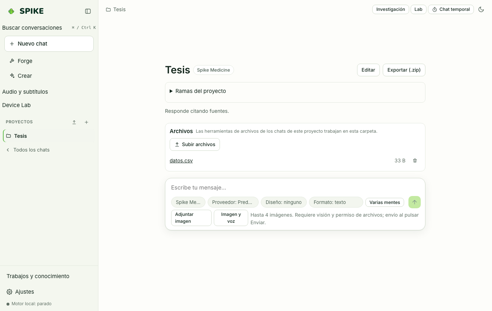

# Proyectos y espacio de trabajo

Idioma: **Español** | [English](../en/projects.md) · [Índice de la guía](README.md)

## Qué hace

Agrupa conversaciones, instrucciones propias, archivos de contexto, sistema de diseño preferido y memoria con ámbito de proyecto (`project:<id>`). Permite subir archivos, previsualizarlos desde el panel lateral del espacio de trabajo y exportar o importar proyectos enteros como archivos `.zip` verificados.

## Cómo se usa paso a paso

1. En la barra lateral izquierda, pulsa **Proyectos** (o el botón `+` junto a Proyectos) para crear un proyecto con nombre, instrucciones, especialista por defecto y sistema de diseño.
2. Dentro del proyecto, sube archivos de referencia (documentos, CSV, código) para que estén disponibles en su carpeta aislada bajo `~/.spike/projects/<id>/files/`.
3. Abre el panel **Archivos** (Workspace Panel) en la cabecera para inspeccionar el árbol de archivos del espacio de trabajo y del proyecto activo.
4. Usa **Exportar ZIP** para guardar el proyecto completo (conversaciones, archivos e instrucciones) o **Importar ZIP** para restaurarlo en otro equipo.

## Límites reales

- La importación de archivos `.zip` valida nombres de ruta, bloquea saltos de directorio (`../`), rechaza enlaces simbólicos y aplica límites de tamaño por archivo y por paquete (`MAX_PACK_BYTES`).
- Borrar un proyecto elimina en cascada sus conversaciones, archivos y memorias de ámbito `project:<id>`; consulta [../../STATUS.md](../../STATUS.md).

## Cómo comprobarlo

- Ejecuta `.venv/bin/python -m pytest -q tests/test_projects.py tests/test_projects_memory_reliability.py`.
- Ejecuta `cd web && npx vitest run src/projectDelete.test.tsx src/workspace.test.tsx`.
