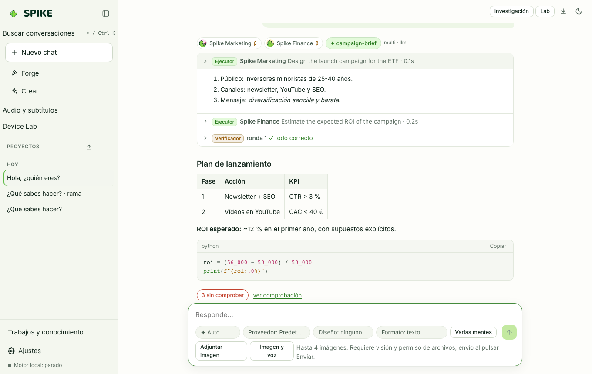

# Especialistas, enrutador y modo Multi-mente

Idioma: **Español** | [English](../en/specialists.md) · [Índice de la guía](README.md)

## Qué hace

SPIKE incluye 13 especialistas de dominio (`Core`, `Code`, `Finance`, `Medicine`, `Law`, `Marketing`, `Science`, `Data`, `Math`, `Education`, `Writing`, `Business`, `Security`) que comparten el mismo modelo base. Un enrutador léxico dirige las consultas claras sin gastar llamadas al modelo (116 de 130 peticiones en un conjunto ciego, 0,89) y **Varias mentes** responde de 2 a 4 veces por separado (cada mente puede tener su especialista y proveedor) y muestra la mejor respuesta según sus etiquetas de comprobación.

## Cómo se usa paso a paso

1. Deja el selector en **Auto** para que el enrutador léxico elija el especialista adecuado, o selecciona uno manualmente.
2. Pulsa **Varias mentes** en el compositor y elige de 2 a 4 **Mentes**: SPIKE muestra la mejor respuesta según sus etiquetas de comprobación (más afirmaciones verificadas, menos sin comprobar). Cada mente solo puede leer y calcular.
3. Abre **Ajustes → Especialistas** para ver el estado real de cada especialista: si responde hoy como **perfil de instrucciones (β)** sobre el modelo base o con un **adaptador LoRA evaluado y cargado**, además de sus capas activas (instrucciones base, tus instrucciones, instrucciones aprendidas y notas en memoria).
4. En **Ajustes → Especialistas**, puedes añadir instrucciones propias por especialista o asignarle un proveedor concreto.

## Límites reales

- Un adaptador LoRA solo se marca como aceptado cuando supera su puerta de evaluación estadística sin perder conocimiento general (caída máxima permitida: 1,5 puntos en MMLU-Pro general).
- Hoy **Medicina** ha superado su criterio de aceptación (**+35,07 puntos** en 2.318 preguntas de MedMCQA, PubMedQA y MMLU-Pro health; **−0,62 puntos** en conocimiento general; SHA-256 `21caa0a0…`, pendiente de publicación). **Finanzas** (ronda 1 a 768 tokens rechazada por una caída de −3,00 puntos en general; ronda 2 a 1536 tokens rechazada: su mejor punto ganó +7,00 en finanzas pero perdió −2,75 en general; la ronda 3 sube la parte de repaso general del 30 % al 45 %) y los demás especialistas responden hoy como **perfiles de instrucciones (β)** sobre el modelo base; consulta [../../SPECIALISTS.md](../../SPECIALISTS.md) y [../../STATUS.md](../../STATUS.md).

## Cómo comprobarlo

- Ejecuta `.venv/bin/python -m pytest -q tests/test_router.py tests/test_minds.py tests/test_specialist_status.py`.
- Ejecuta `cd web && npx vitest run src/specialists.test.tsx`.
